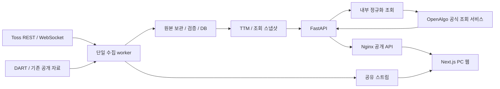

# 국내증시 PC 개편 실행 기록

기준: 2026-10-03 KST. 최종 실행 버전: `20261003-toss-desktop-v6`. 공개 주소: https://stocks.62-171-141-206.sslip.io/stocks

## 실제 구현·연결

| 항목 | 구현 | 실제 자료 | 화면 확인 | 공개 반영 |
|---|---|---|---|---|
| 검색창·간결한 종목 요약·4개 상위 메뉴 | 적용 | 기존 전 종목 목록 유지 | Chrome 검색/키보드 이동 확인 | 반영 |
| 선·5분 캔들·거래량·날짜 선택 | Lightweight Charts | 대표 종목 Toss OHLC | 선/캔들 전환 확인 | 반영 |
| 관심 저장·취소·보조 목록·큰 글씨 | 적용 | 브라우저 기존 저장값 유지 | 저장/취소, 확대 선택 확인 | 반영 |
| Toss 인증·REST·공유 WebSocket | 적용 | 가격/호가/체결 내역/차트 조회 성공 | 실제 장중 새 이벤트는 미검증 | 반영 |
| 수급·프로그램·대차·신용·공매도 거래 | Toss 정규화 어댑터 | 조회 중인 종목 수집 중 | 수급 화면 실제 숫자 확인 | 반영 |
| OpenAlgo 읽기 연결 | 공식 service 함수 + 조회용 Toss 어댑터 | 공개 bars에서 transport=openalgo, 주봉 638개 | API 확인 | 반영 |
| DART 기간 검증 TTM | 기간/연결/누적 차감 검증 | 삼성전자·SK하이닉스 각각 연결 5항목·별도 5항목 | 공개 valuation의 TTM 반환 확인 | 반영 |
| 실적과 주가 비교선 | 계산·표·차트 구현 | 대표 종목의 검증된 주당지표 입력은 부족 | 현재 실제 가격선만 표시 | 부분 반영 |
| 예상실적·배당 포함 성과·기업행사 | 기존 경로 유지 | 전체 확보/정합성 미검증 | 미검증 | 전체 완료 아님 |
| 1024/1280/1440/1920 화면·200% 확대 | 반응형 규칙 적용 | 해당 없음 | 996px·1440px 확인, 전체 조합 미완료 | 기본 반영 |
| 독자 마스코트 | 빈 관심 화면에 제한 적용 | 생성 이미지 | 차트에 겹치지 않음 | 반영 |

시장 목록 2,875개가 보인다는 것은 Toss의 모든 자료 2,875개가 확보됐다는 뜻이 아니다. 별도 256MiB 감사 프로세스로 저장 스냅샷 전체를 순차 검사한 결과는 다음과 같다. 이는 저장 유무 집계이며 종목×자료×기간별 원천 대조와 완전성 검사를 대신하지 않는다.

| 저장 검사 항목 | 결과 | 범위와 한계 |
|---|---:|---|
| 등록 종목 | 2,875 | 자료별 확보 여부와 별개 |
| Toss 통합 일별 가격이 있는 종목 | 10 | 필요한 10년을 모두 채웠다는 뜻이 아님 |
| 일별 가격 2,000행 이상 | 2 | 대표 두 종목은 각각 3,000행 |
| Toss 신용·대차·대주 중 하나 이상 존재 | 9 | 세 자료를 모두 확보한 종목 수가 아님 |
| 공식 자료 스냅샷 | 2,760 | 스냅샷 존재이며 전체 재무 확보율이 아님 |
| 연결 TTM 계산 결과가 있는 회사 | 3 | 계산기가 기간 조건을 통과시킨 회사 수 |
| 연결 TTM 결과 행 | 286 | XBRL 계정·차원 포함, 모두 수작업 대조한 지표 수가 아님 |

대표 회사의 주요 손익 검증과 전체 스냅샷 집계를 구분한다. 전체 집계는 `desktop-coverage-20261003.json`에 보존했다.

공개 PC 화면 — SK하이닉스 시세 (로컬 보존 자료: `screenshots/desktop-public-20261003.png`)

## 연결 구조

OpenAlgo 내부 조회는 공개 bars를 재호출하지 않는다. 따라서 위 왕복은 과거 조회의 요청·응답이며 재귀 수집 구조가 아니다. 주문·계좌 경로는 제공하지 않는다.

## 실제 자료 검증

- Toss 신규 인증과 VPS 허용 IP 등록을 완료했다. 키 값과 토큰은 서버 비밀 파일에만 보관한다.
- 대표 두 종목은 일별 가격 각 3,000개와 분봉 각 1,000개를 조회했다. 조회 기간이 다른 자료를 현재 하루 차트로 표시하던 문제를 수정했다.
- 관찰 시점 WebSocket의 10종목 × 체결/호가 20개 구독이 승인됐고 거절은 없었다. 장 마감 후였으므로 새 장중 이벤트 수신·화면 반영까지 완료라고 표시하지 않는다.
- 삼성전자 XBRL 3,391개, SK하이닉스 두 보고서의 4,600개/3,789개 원문 사실을 실제 저장했다. 장기 계정명이 varchar(180)을 넘는 오류는 account_id를 text로 확장해 해결했다.
- 대표 TTM 기간은 2025-07-01~2026-06-30. 매출액은 전년도 연간 + 당해 반기 − 전년 반기와 일치했다. 이는 손익 금액 검증이며 TTM EPS 검증이 아니다.
- 공개 valuation 응답은 주당지표 근거 부족을 price_only / comparison=false로 반환한다. EPS·분할 기준을 임의로 검증 완료로 바꾸지 않았다.

## 성능 측정

동시 100개, 항목별 300요청. 워밍업 100연결. 공개 검색·상세 요약에만 최대 1초의 서버 캐시를 적용했다. 인증 헤더·쿠키 요청, 호가·스트림·심화 분석에는 이 캐시를 사용하지 않는다. 장애 시 무기한 오래된 값을 제공하는 설정은 사용하지 않는다.

| 경로 | 검색 p95 | 요약 p95 | 오류 | 판단 |
|---|---:|---:|---:|---|
| VPS 내부 HTTPS → Nginx 공개 경로, WAN 제외 | 183.25ms | 118.67ms | 0 | 서버 캐시 조건 목표 통과 |
| PC → 공개 HTTPS, 인터넷 포함 최종 측정 | 527.46ms | 1,621.84ms | 0 | 실제 PC 경로 목표 미달 |

변경 전 Next.js 경유와 서버 캐시 도입 후는 경로·캐시 조건이 달라 전체 서비스 10배 개선으로 해석하지 않는다. 측정 JSON은 desktop-load-server-20261003.json과 desktop-load-public-wan-final-20261003.json에 있다. LCP/INP/CLS는 아직 종합 측정하지 않았다.

## VPS·복구

- /srv/services/korea-stocks/releases와 current, shared/secrets 경로를 적용했다. 이전 /srv/hannun과 기존 DB 볼륨을 보존했다.
- API·웹 포트는 루프백, DB·Redis·OpenAlgo는 내부 네트워크다. 공개 내부 진단 및 계좌 경로는 404를 확인했다.
- 주요 서비스 메모리 한도 합계는 3,840MiB. 다른 프로젝트의 앱/DB/프록시 설정은 변경하지 않았다.
- 배포 전 검색 점검 실패 시 이전 서비스로 자동 복귀하는 실제 동작을 확인했다. 새 버전 배포 시 과거 DB를 복원하지 않는다.
- 정기/배포 전 백업 보존을 분리했다. 정기 백업은 04:20 KST, 일별 7개·주별 4개 보존이다.
- 최신 백업 market-20261002T165329Z.dump: 186,308,170 bytes. 별도 임시 DB 복원으로 5개 테이블을 확인했다.
- PC의 암호화 사본은 AES-256-GCM, 복구 키는 현재 Windows 계정의 DPAPI로 보호한다. 복호화 내용 SHA-256도 일치했다. 이 키는 현재 Windows 프로필에 묶이므로 프로필 없이 독립적으로 복구 가능한 키 보관 체계는 별도 과제다.
- 비공개 운영 점검은 2분마다 실행하고, 정상 시 외부 알림을 보내지 않는다. 실패 시 systemd 상태 및 shared/monitor.json에서 확인한다.
- 첫 전체 자료 감사는 메모리 한도에 걸려 중단됐다. 이후 별도 256MiB·0.25CPU 컨테이너에서 서버 커서로 한 행씩 읽어 저장 스냅샷 집계를 완료했다. 조회 서비스와 감사 메모리를 분리했고 공개 v6 건강 상태를 다시 확인했다. 자료별 원천 대조까지 완료한 것은 아니다.

## 검증과 남은 작업

- 변경 관련 Python 테스트 78개 통과. FastAPI TestClient의 httpx 사용 중단 예정 경고 1종이 남았다.
- Next.js 프로덕션 빌드와 TypeScript 검사 통과.
- 실제 Chrome 공개 화면에서 검색/키보드 종목 이동/선·캔들/수급/기업 분석/관심 추가·취소 확인.
- 996px·1440px 창에서 페이지 가로 넘침 없음, 종목 요약 position:static 확인. 1440px 창의 그래프 시작 위치 270.86px, 그래프 높이 360px로 측정했다. 시작 위치 260px 목표는 약 11px 미달이다. 더 크게 설정의 대표 가격은 40px이다. 전체 데스크톱 크기 조합과 아버님 실사용은 별도 미완료다.
- 남음: 전 종목·과거 기간 감사 및 누락 수집, 주당지표·기업행사 검증, 전체 기업 분석 목차 전환, 장중 이벤트·강제 재연결 검증, WAN 성능과 Core Web Vitals, PWA 업데이트/오프라인, 아버님 사용 과제.

## 주요 코드

- apps/web/app/stocks/workspace.css: PC 레이아웃과 글자 규칙
- apps/web/components/market/{dashboard,header-search,detail,financial-chart,valuation-chart,activity-panel}.tsx
- services/market_dashboard/{toss,app,openalgo_bridge,fact_store,xbrl_facts}.py
- ops/openalgo/: 공식 OpenAlgo 읽기 연결과 공개 소스 묶음
- ops/market/: 배포/백업/비공개 점검/공개 조회 캐시

## 마스코트 제작 기록

도구: image_gen.imagegen. 결과: apps/web/public/stocks/mascot.png. 성인 여성형 SD 안내 캐릭터, 안경, 간결한 금융 서비스 안내자, 비성적 표현, 투명 배경, 텍스트/상표 없음이라는 방향으로 생성했다. 정확한 최종 프롬프트와 도구 호출은 `docs/mascot-generation-prompt.txt`에 보존했다. 도움말·빈 관심 화면 외에 가격/차트/호가 위에는 사용하지 않는다.
