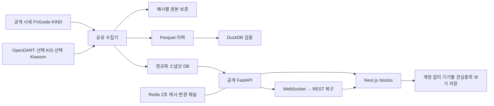

# 국내증시 — 주식 대시보드

**현재 개발·배포 기록: 2026-10-03 v18** — https://stocks.62-171-141-206.sslip.io/stocks

Toss·DART 기반 PC 공개 서비스입니다. 선·영역·캔들·OHLC, 실적 증감률과 표, 2015년 이후 재무 선택, 장기 수급·기관 세부·프로그램, 공시·뉴스 분류를 추가했습니다. [최신 개발·검증 기록](remaining-development-v18-20261003.md)과 [토스 API 계약](toss-api-contract.md)을 먼저 확인하세요. 전체 자료 수집, 검증된 주당 실적 비교선, 장중 새 체결 및 인터넷 경로 성능·실사용 검증은 남아 있습니다. 아래는 날짜별 과거 기록이며 현재 완료 범위를 뜻하지 않습니다. 과거 키움·한투·모바일 우선 문구보다 최신 Toss·PC 방향을 우선합니다.

## 과거 작업 기록

**2026-09-28 최신 실행본:** http://127.0.0.1:3243/stocks — [검색 성능·실제 연결·TTM·배포 검증](search-live-ttm-release-20260928.md). 웹 검색은 동시 연결 100개에서 p95 **184·148·106ms**로 3회 모두 300ms 목표를 통과했습니다. 지정 종목 TTM 재수집·재시도와 최신 배포 패키지까지 준비했습니다. 실제 증권사 수신은 한투 보안프로그램 설치·본인 로그인, 실제 TTM 수집과 서버 반영은 실행 환경의 외부 접속 제한으로 미완료입니다. 최신 빌드는 `.next-search-v27`, API는 8243입니다.

**2026-09-28 앞선 로컬 구현:** [통합 개발·검증 기록](integration-implementation-20260928.md). 당시 미리보기는 http://127.0.0.1:3232/stocks 입니다. 연속 가격 분석 화면·XBRL/기간 저장·키움 거래정보·KRX/한투 보완 조회 경로를 추가하고 DART 기간 재무 사실 23,747건을 복구했습니다. 큰 글씨와 발행주식·주주 펼침을 보완하고, 빌드/실행 API 주소 불일치를 시작 전에 검사합니다. 아래 과거 배포 기록과 구분하며, 실제 TTM EPS·장중 수신·최신 공개 배포는 미완료입니다. 이름은 **국내증시**로 유지합니다.

**배포 실행기:** [접속 확인·백업·배포·자동 복구](release-runner.md)를 구현했습니다. 관련 백엔드 검사 76개 통과. 현재 실행 환경의 네트워크 권한 미부여로 실제 서버 반영은 미완료입니다.

**2026-09-26 후속 구현:** [대차·신용·실시간 보강 기록](financing-implementation.md). 수급 안에 대차잔고·신용융자·신용대주 화면과 독립 수집 큐를 연결하고 실시간 구독 거절·중복 체결 처리를 보완했습니다. 현재 로컬 실행은 http://127.0.0.1:3216/stocks 입니다. 실제 증권사 수신과 최신 공개 배포는 아래 구현 검사와 구분합니다.

**2026-09-26 로컬 구현:** [모바일 수급·공매도 구현 기록](mobile-mts-implementation.md). 모바일 네 메뉴, 수급 기간·터치 차트, 증권사별 순위, 공매도 거래/잔고 화면·독립 수집기를 추가했습니다. 공매도 실제 원천 수신과 공개 배포는 아직 확인되지 않았습니다.

**당시 설계 기준:** [휴대폰 중심 제품 설계 v3](market-product-plan-v3.md). 종목 검색·가격/차트·관심 저장·복귀를 먼저 완성한 뒤 수급·거래원, 공매도 거래/잔고, 대차·신용 순서로 확장합니다. 문서의 목표 화면과 현재 운영 구현은 구분합니다.

2026-09-25 개선·공개 배포본. 네이버페이 증권처럼 순위·기업 정보를 우선하는 방향을 적용했습니다. ‘국내증시’는 임시 화면 제목이며 최종 브랜드는 미정입니다. 누구나 로그인 없이 사용할 수 있는 별도 `/stocks` 서비스입니다. 기존 개인용 `/terminal`은 그대로 두고 API와 저장소를 분리했습니다. 관심종목과 저장 보기는 현재 브라우저에 저장합니다.

**공개 화면:** https://stocks.62-171-141-206.sslip.io/stocks  
**로컬 화면:** http://127.0.0.1:3210/stocks  
**API 상태:** http://127.0.0.1:8210/api/market/v1/health  
**API 명세:** http://127.0.0.1:8210/docs

## 사용할 수 있는 기능

- 시장 홈: 코스피·코스닥·코스피200 실제 미니 차트와 펼치는 기간 차트, 장중/장 마감 시장 요약, 종목 순위, 업종 집계, 264개 테마 검색·편입 기업, 상위 종목 지도, 최근 공시, 관심·최근 종목.
- 종목 찾기: 시장·검색어·AND/OR 숫자 조건, 14개 지표, 열 선택·순서·너비, 정렬, 저장 보기, 페이지 이동.
- 종목 상세: 기업 로고·개요, 장중·주간 차트, 장기 일·주·월봉·거래량·20봉 이동평균, 기간별 주가 수익률, 실적·수급 그래프, 거래원, 재무·주주·공시 원문. PC는 차트와 지표를 나란히 표시합니다.
- 기업·주주: DART 사업보고서의 최대주주·배당·직원·임원·발행주식 정보를 자동 보강하고, 긴 표는 접어서 표시합니다.
- 주가·이익 보기: 연간 연결 실적 EPS와 결산월 말 가격, 사용자가 선택한 배수의 계산값. 자동 투자 의견은 생성하지 않습니다.
- 비회원 관심종목·그룹, 최근 종목, 2~4개 비교. 상세에서 돌아와도 목록 조건과 읽던 위치를 유지합니다.
- 지표별 쉬운 설명·산식·기간·단위, 키보드로 닫기와 초점 복귀.
- 라이트·다크·시스템 테마, 큰 글씨, PC 조밀 보기, 모바일 전용 목록·하단 메뉴·전체 표.
- WebSocket 변경 전달, REST 대체 조회, 연결 끊김 표시, 명시적 순위 새로고침. 숫자 갱신 때문에 읽던 행을 이동시키지 않습니다.
- PWA manifest와 서비스 워커. 오프라인에서는 연결 상태를 안내하며 금융 API 응답을 오래된 실시간 값으로 재사용하지 않습니다.

## 실행

이 폴더에는 `.venv`, 웹 의존성, 실제 수집 DB, 배포용 빌드가 준비되어 있습니다. 현재 실행 중이면 위 화면 주소로 바로 확인합니다. 종료 후에는 PowerShell에서 다음을 실행합니다.

```powershell
Set-Location 'C:\Users\lch68\Documents\Codex\2026-09-24\x20\outputs\korea-stock-dashboard'
.\scripts\start-market.ps1
```

실행 스크립트는 창을 숨긴 API·수집기·웹 프로세스를 시작하고 `storage/public-market/run/`에 로그와 PID를 기록합니다. 같은 포트에 기존 서비스가 있으면 중복 시작을 막습니다. 외부 API 키 없이 공개 시세·기업·재무 자료를 사용할 수 있습니다.

새 환경에서 처음 설치할 때:

```powershell
python -m venv .venv
.\.venv\Scripts\python.exe -m pip install -r ops/market/requirements.txt
pnpm install --frozen-lockfile --ignore-scripts
pnpm --filter @personal-fastgraphs/web build
.\scripts\start-market.ps1
```

수집기만 한 번 실행하거나 개발 서버로 실행하려면 각각 별도 터미널에서:

```powershell
.\.venv\Scripts\python.exe -m services.market_dashboard.worker --once
.\.venv\Scripts\python.exe -m uvicorn services.market_dashboard.app:app --host 127.0.0.1 --port 8210 --ws websockets-sansio
pnpm --filter @personal-fastgraphs/web dev --port 3210
```

## 데이터 확보 상태

검수 중 저장된 목록은 **2,872개 상장 증권**(KOSPI 944·KOSDAQ 1,821·KONEX 107), KIND 회사 목록은 종목코드 중복 제거 후 **2,756개**였습니다. KIND 원문의 2,799행에는 43개의 반복 행이 있었으며 원본을 보존하고 회사 집계에서 중복을 제거했습니다. 종목과 회사는 같은 개념이 아니므로 이 수를 하나의 회사 수로 표시하지 않습니다. 숫자는 이후 수집으로 바뀔 수 있습니다.

| 데이터 | 현재 연결 | 범위와 차이 |
|---|---|---|
| 종목 목록·시세·거래량·거래대금·시총 | 네이버 공개 응답 + KIND 상장 목록 | ETF/ETN 제외. 목록에 있어도 원천 시세가 없으면 결측 표시 |
| 지수 | 네이버 공개 응답 | 거래 시각과 수집 시각은 내부 검증에 쓰며 사용자 화면에는 표시하지 않음 |
| 업종·상장 정보 | KIND | 업종 등락은 확보된 종목의 등락률 단순 평균. 시장 전체 지수와 다름 |
| 수급·외국인 지분율 | 네이버 공개 투자자 집계 | 외국인 보유 비율 사용. 외인 한도 소진율을 지분율로 혼용하지 않음 |
| 재무·주주 | FnGuide 공개 스냅샷 | 종목별 순차 수집. 스냅샷이 제공하는 기간·연결/별도·실적/추정 범위만 표시 |
| 가격 이력 | 네이버 일봉 원천 | 최대 2,600개 원천 일봉 요청. 조정주가 방법은 미확인으로 표시 |
| 공시·공식 재무제표·기업 개황 | OpenDART 실제 연결 | 기존 키를 재사용. 홈에는 최근 14일 최신 100건의 시장 공시를 표시하고, 종목 상세에는 최근 1년 최신 100건 공시·직전 연도 전체 재무제표와 주요계정·최대주주·배당·직원·임원·발행주식 정보를 순환 수집 |
| 증권사 거래원 | 네이버 공개 거래원 집계 실제 연결 | 매수·매도·순매수 제공. 키움 REST/WebSocket 읽기 전용 어댑터는 구현했지만 운영 서버 IP 허용과 서버 키 등록 전까지 자동 활성화되지 않음. 한국투자증권 인증 API도 별도 연결 전 |
| 사용자 설정 | 브라우저 로컬 저장 | 계정 없이 관심종목·그룹·저장 보기·테마를 이 기기에 저장 |

전체 종목의 **모든 FnGuide 항목**, 검증된 TTM, 모든 종목의 전체 재무제표, 모든 종목의 과거 발표 시점, KRX+NXT 통합 실시간 틱까지 확보한 상태는 아닙니다. 홈 공시 피드는 첫 100건이며 전체 검색은 공시 서비스로 이동합니다. 수집기는 화면에서 조회한 종목을 우선 처리하면서 전체 종목을 체크포인트 기반으로 순회합니다. 실제 자료 범위와 수집 상태는 내부 운영 기록에서 확인하며 일반 사용자 화면에는 노출하지 않습니다.

시장 전체 자료는 자동 작업자가 주기적으로 갱신하고, 보고 있는 종목은 수집 우선순위를 높입니다. 공개 시세 폴링은 보완 경로입니다. 키움 실시간 체결은 읽기 전용 WebSocket으로 설계했으며, 운영 서버 IP가 키움 개발자 포털의 허용 목록에 추가되고 서버 비밀 설정에 키가 들어간 뒤에만 활성화됩니다. 실제 계정 응답을 확인하기 전에는 운영 실시간 연결로 간주하지 않습니다.

## 저장·서버 구조



로컬은 SQLite로 즉시 실행합니다. 운영용 `compose.market.yml`은 별도 PostgreSQL·Redis·API·수집기·웹을 구성합니다. 원본과 정규화 시계열은 `storage/public-market/`에 보관하며 Git과 Docker 빌드 컨텍스트에서 제외했습니다. 원본은 내용 해시별로 보존하고 재무 변경 이력을 원문으로 추적합니다. 완성된 과거 시점 재무 조회 엔진까지 제공하는 것은 아닙니다.

## 실제 클라우드와 추가 연결

`ops/market/.env.example`에 필요한 환경변수 이름이 있습니다. 비밀값은 Git에 넣거나 `NEXT_PUBLIC_*`로 노출하지 않습니다. Python 실행 전 프로세스 환경변수에 주입하고, Next 웹의 개발 환경은 `apps/web/.env.local`을 사용할 수 있습니다.

- 공시: `DART_API_KEY`.
- 거래원: `MARKET_KIS_APP_KEY`, `MARKET_KIS_APP_SECRET`, `MARKET_KIS_VENUE=J` 또는 `NX`. 주문 API는 구현하지 않았습니다.
- 선택 실시간 체결: `MARKET_KIWOOM_APP_KEY`, `MARKET_KIWOOM_SECRET_KEY`. 키움 개발자 포털에 운영 서버 IP를 등록해야 하며 공개 종목 시세 읽기에만 사용합니다. 주문·계좌 API는 호출하지 않습니다.
- HTTPS 공개 주소: `MARKET_PUBLIC_ORIGIN=https://실제주소`. 프록시는 `/api/market/v1/stream`의 Upgrade/Connection을 전달해야 합니다.
- PostgreSQL: `MARKET_DATABASE_URL=postgresql+psycopg://...`; Redis: `MARKET_REDIS_URL=redis://...`.

```sh
docker compose --env-file ops/market/.env -f compose.market.yml up -d --build
```

기존 VPS에서 별도 Compose 프로젝트를 실행했습니다. 웹·API는 루프백 포트에만 연결하고 별도 Nginx 가상 호스트로 공개합니다. PostgreSQL·Redis·공유 수집기·웹이 실행 중이며 TLS 인증서 자동 갱신을 설정했습니다. 기존 Mirae 컨테이너와 서비스 경로는 유지했습니다.

DB는 서버 내부에 매일 백업하고 최근 7개를 보관합니다. 첫 백업 생성과 읽기 검사를 수행합니다. 이는 서버 장애에 대비한 외부 백업을 대신하지 않습니다. 운영 경로와 재시작·복구 절차는 `docs/market-deployment.md`에 있습니다. 새 유료 상품은 구매하지 않았습니다.

## 전 종목 데이터 메타데이터 감사

현재 상장 주식 목록은 KOSPI 944개, KOSDAQ 1,821개, KONEX 107개로 총 2,872개입니다. 공개값이 있는 스크리너 지표를 전 종목 페이지로 확인하고, 숫자마다 사실값·기준기간·단위·출처 URL·원본 응답 해시·수집시각이 일치하는지 내부 점검할 수 있습니다. 일반 화면에는 출처명·수집시각·원천 한도를 표시하지 않습니다.

```powershell
.\.venv\Scripts\python.exe scripts/audit_market_metadata.py `
  --base-url 'https://stocks.62-171-141-206.sslip.io/api/market/v1' `
  --output docs/market-data-audit-20260925.json
```

2026-09-25 운영 감사는 **2,872/2,872개 종목, 중복 0, 메타데이터 위반 0**으로 통과했습니다. 당시 지표 값은 현재가·등락률 2,847개, 거래량 2,825개, 거래대금·시가총액·외국인 지분율·외국인/기관 순매수 2,765개, PER 1,757개, PBR 2,741개, ROE 2,661개, 배당수익률 1,353개, 매출 2,643개, 영업이익 2,713개였습니다. 수집기는 계속 순환 보강하므로 이 수치는 스냅샷이며, 빈 값은 0으로 채우지 않습니다. 전체 FnGuide 재무항목·과거 발표 시점·통합 거래소 실시간 틱이 전 종목에서 확보됐다는 뜻은 아닙니다. 결과와 시작·종료 시점의 커버리지는 `docs/market-data-audit-20260925.json`에 기록합니다.

감사 시점의 모든 비결측 숫자는 사실값과 단위가 일치하고, 같은 기준기간을 가진 출처 기록 및 원본 응답 해시와 연결되어 있었습니다. 공개 원천이 별도의 최초 공개시각을 제공하지 않는 경우 `available_at`은 미확정으로 두며, 사실 기준기간과 내부 수집시각을 별도로 보존합니다. 해당 값의 과거 특정 시점 이용 가능성을 소급해 주장하지 않습니다.

2026-09-25 14:18 KST 운영 API를 다시 전수 감사했습니다. 2,872/2,872개 종목 코드가 고유했고, 비결측 14개 지표의 값·기간·단위·출처 URL·응답 해시·내부 수집시각 위반은 0건이었습니다. 당시 현재가·등락률 2,871개, 거래량 2,843개, 거래대금·시가총액·외국인 지표 2,765개, PER 1,757개, PBR 2,741개, ROE 2,683개, 배당수익률 1,354개, 매출 2,669개, 영업이익 2,740개였습니다. 결과는 `docs/market-data-audit-live-20260925.json`에 보존했습니다. 과거 최초 공개 시각을 제공하지 않는 원천의 `available_at`은 미확정으로 남깁니다.

OpenDART의 다중회사 주요계정 API를 이용한 재무 보강도 운영 중입니다. 최대 100개 회사 단위로 이어받기 가능한 작업을 수행하고, 연결·별도 사업보고서의 재무상태표와 손익 주요계정을 저장합니다. 이 응답은 전체 재무제표가 아니며 기존 단일회사 전체 재무제표를 덮어쓰지 않습니다. 종목 페이지는 두 범위를 각각 “사업보고서 주요 계정”과 “사업보고서 재무제표”로 표시합니다. 2026-09-25 14:54 KST 운영 확인에서 전체 2,756개 대상 중 진행 오프셋 200, 최근 DART 응답 성공을 확인했습니다. 전 종목 순회는 자동으로 이어지고 있으며 아직 완료 단계가 아닙니다.

## 검증과 남은 확인

- Next.js 배포용 빌드 및 TypeScript 검사 통과.
- `scripts/start-market.ps1`로 API·수집기·배포용 웹 재시작 성공. 실제 프록시 검색 응답과 API 상태를 확인했습니다.
- 신규 프런트엔드 ESLint, 신규 Python Ruff 검사 통과.
- 서버 계약 테스트 10개 통과: 단위, 결측, AND/OR, 실적/추정, 코드 검증, 회사 중복 제거, 거래원 결측, 원본 보존, 저장 충돌, 서명 인증, 역전 방지, WebSocket, Parquet/DuckDB.
- 공개 로그인 제거 배포 직후 브라우저 검사는 13/13 통과했지만, DART 보강 배포 뒤 전체 14개 운영 검사는 10개 통과·4개 실패였고 전용 DART 재무 화면 검사는 통과했습니다. 실패 테스트 일부를 재실행해 3개는 통과했고, 남은 1개는 공개 주소 탐색 시간 초과였습니다. 최신 `docs/market-browser-results.json`은 현재 코드가 아닌 오래된 로컬 3210 프로세스를 향해 실행된 결과라 제품 코드의 합격 근거로 쓰지 않습니다. 운영 환경의 안정적인 전체 재검증이 남아 있습니다.
- 로컬 Node HTTP 부하 시험: 100개 연결 × 총 300요청/항목, gzip 전체 응답 수신. 최근 결과 검색 p95 **95.86ms**, 상세 p95 **82.07ms**, 오류 0건. `docs/market-load-node-results.json` 참조. 화면 렌더링·원천 수집·클라우드 성능을 의미하지 않습니다.
- 별도 Python/httpx 100동시 시험은 검색·상세 p95가 수 초였고 측정 도구 간 차이가 있었습니다. 결과를 `docs/market-load-results.json`에 보존했습니다. 운영 전에는 별도 부하 발생기와 서버 관측을 함께 사용해 재검증해야 합니다.
- 중장년 2명 포함 5명의 실제 사용성 시험, 실제 200% 브라우저 확대, 스크린리더 전체 감사, PWA의 iOS/Android 설치, 키움 운영 서버 IP 허용 및 실시간 응답은 아직 실제 환경에서 확인할 항목입니다.

2026-09-25 격리 production 빌드와 로컬 API를 연결해 핵심 Playwright 시나리오 15/15 통과했습니다. 360·390·768·1440px, 라이트·다크, 비회원 사용, 종목 검색·상세·비교와 DART 기업 정보 표시를 포함합니다. 이 브라우저 결과는 `docs/market-browser-results.json`에 있습니다. 이번 DART 추가분은 원격 운영 서버에 아직 배포하지 않았습니다.

```powershell
Set-Location 'C:\Users\lch68\Documents\Codex\2026-09-24\x20\outputs\korea-stock-dashboard'
.\.venv\Scripts\python.exe -m pytest tests/test_public_market.py tests/test_market_metadata_audit.py -q
.\.venv\Scripts\ruff.exe check services/market_dashboard tests/test_public_market.py scripts/audit_market_metadata.py tests/test_market_metadata_audit.py
.\.venv\Scripts\python.exe scripts/audit_market_metadata.py --base-url 'https://stocks.62-171-141-206.sslip.io/api/market/v1'
Set-Location apps/web
node node_modules/@playwright/test/cli.js test --config playwright.market.config.ts
node node_modules/eslint/bin/eslint.js components/market app/api/market app/stocks/page.tsx
```

## 핵심 파일

| 파일 | 역할 |
|---|---|
| `apps/web/components/market/dashboard.tsx` | 시장·표·검색·비교·저장과 화면 상태 |
| `apps/web/components/market/detail.tsx` | 종목 상세 탭과 재무·수급·주주 |
| `apps/web/components/market/mobile-list.tsx` | 작은 화면용 읽기 쉬운 목록 |
| `apps/web/app/stocks/market.css` | 독립 디자인 토큰·테마·반응형 |
| `services/market_dashboard/providers.py` | 실제 공개 원천 수집·정규화 |
| `services/market_dashboard/authenticated_sources.py` | OpenDART·KIS 선택 연결 |
| `services/market_dashboard/kiwoom_stream.py` | 키움 읽기 전용 실시간 체결 연결 |
| `services/market_dashboard/app.py` | 검색·상세·필터·지표·WebSocket API |
| `services/market_dashboard/store.py` | 원본·DB·Redis·Parquet·개인 설정 |
| `services/market_dashboard/worker.py` | 배치·활성 종목·재시작 체크포인트 |
| `docs/PUBLIC_DASHBOARD_DESIGN.md` | 설계 판단·레퍼런스 적용 |

참조: [KIND 상장 목록](https://kind.krx.co.kr/corpgeneral/corpList.do?method=loadInitPage), [OpenDART 공시 API](https://opendart.fss.or.kr/guide/detail.do?apiGrpCd=DS001&apiId=2019001), [OpenDART 다중회사 주요계정 API](https://opendart.fss.or.kr/guide/detail.do?apiGrpCd=DS003&apiId=2019017), [KIS 거래원 공식 예제](https://github.com/koreainvestment/open-trading-api/tree/main/examples_llm/domestic_stock/inquire_member), [FAST Graphs 역사 차트](https://docs.fastgraphs.com/en/articles/9419962-historical-graph).


화면 개편 근거와 흐름: [UX 개선 기록](market-ux-v2.md). 최신 배포 검증: [공개 배포 기록](market-deployment.md).
