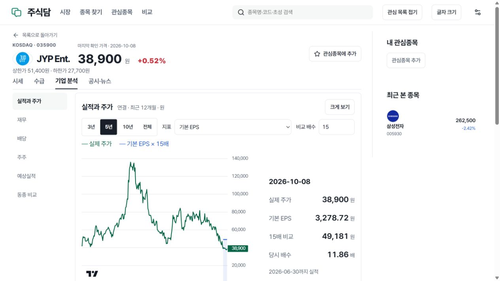

# v127 검증 기록 — 주석 수집 연결과 JYP TTM 입력

상태: **부분 검증 기록 · 전체 완료 아님**  
대상 릴리스: `20261010-ttm-queue-v127`  
기록일: 2026-10-10 KST. 후속 근거 반영: 19:49:52까지의 공개 자료·브라우저·운영 관측 및 v127 100연결 시험. 아래 시각은 별도 표시가 없으면 KST입니다.

## 이번에 확인한 결과

기존 주식 기준 검토를 마친 기업의 미처리 EPS 주석이 자동 큐에서 제외되는 경로를 수정했습니다. 회사·공시·공개일이 맞는 검토된 주석만 선택하며, 같은 버전의 완료 자료와 재시도 대기 자료는 건너뜁니다. 이미 저장한 사실이나 분할 기준을 다시 등록해 확보량을 늘리지 않습니다.

JYP Ent.(035900)는 보존 원문에 근거한 새 사실 12개를 추가하고 기존 사실 16개를 대조했습니다. 두 TTM EPS 구간의 계산과 공개 응답을 확인했습니다. 초기 적용 때는 현재가 비교를 승인하지 않았으나, 후속 공시창 검토로 주식 단위창을 2026-10-08까지 연장한 뒤 두 공개 가치평가 응답에서 실제 비교가 통과했습니다. 검증된 날짜 밖과 전체 과거 기간까지 승인한 것은 아닙니다. 수집 재개, TTM 계산, 주가 비교, 전체 과거 자료 완료는 서로 다른 판정입니다.

| 항목 | 구현 | 실제 자료 | 화면·공개 검증 | 판정 |
|---|---|---|---|---|
| 검토 기업의 미처리 EPS 주석 큐 | 수정 및 회귀 통과 | 운영 큐에서 새 처리된 사실 수는 이 문서에서 미관측 | v127 적용 후 자동 처리 결과 추가 확인 필요 | 코드 수정 완료, 실제 확대 미판정 |
| JYP EPS 입력·TTM | 기존 계산·투영 경로 사용 | 기존 16개 대조, 신규 12개 삽입, TTM 2구간 일치 | 두 공개 주소의 저장된 주당지표 응답에서 확인 | 제한된 실제 기간 검증 |
| JYP EPS 가격 비교 | 기존 검증 계약 유지 | 검토 단위창 종료 2026-10-08, 기존 사실 불변 | 두 v127 가치평가 응답의 `availability.comparison=true` | 검증된 날짜 범위 통과 |
| 전 종목 과거 수집 | 용량 정책 변경 후 재개 관측 | 18:55→19:34 작업 진행 증가, 2,765 대상 | 전체 자료의 전행 검증 아님 | 진행 중 |
| 정적 화면 | v126 검증 산출물 재사용 | 파일 73개, 24,338,975바이트 | 두 주소 총 20개 공개 검사 통과 | 새 UI 빌드 아님 |
| 배당 날짜·기업행사 | 기존 연결 유지 | 권리일·배당락일·지급일 근거의 빈칸 잔존 | 이번 변경으로 완료 처리하지 않음 | 미완료 |
| 장중 체결·호가 | 기존 연결 유지 | 휴장 중 새 체결 검증 없음 | 2026-10-12 실제 장중 검증 예약 | 미완료 |
| 최신 로컬 전체 복원 | 기존 복원 작업 | 진행 중, 완료 결과 미확보 | 운영 테이블 전환·공간 회수 증거 아님 | 미완료 |
| v127 성능 | 100개 독립 TLS 연결 시험 완료 | 2,000요청 중 타임아웃 1건 | 모든 단계의 p95 목표 미달 | 미완료 |

## 관측 시점과 범위

- **18:55:53**: v126 수집 재개 후 읽기 전용 확보율 감사. 정확한 대상 2,765종목, 124개 조회, 22.293초. 용량 제한 해제와 작업 커서를 관측했으며, 전체 원본이나 재무 사실을 전행 검사한 결과가 아닙니다.
- **19:19:51**: JYP 원문 기반 적용 기록. 당시 실행 릴리스는 `20261010-storage-resume-v126`입니다. 공급자 요청 0회, 기존 사실 16개 대조, 신규 사실 12개 삽입, 원문 문서 22개, 파생 투영 재생성 기록이 있습니다.
- `jyp-public-v126.json`: 두 공개 주소의 JYP 주당지표 응답입니다. 파일 자체에 관측 시각·릴리스 필드가 없으므로 이를 v127 배포 뒤의 새 조회로 바꾸어 표현하지 않습니다.
- **19:22:28**: v127 정적 산출물 재사용 기록. 원본 빌드 시각은 **18:48:08**, 원본 릴리스는 v126이며 `new_compilation=false`입니다.
- **19:29:50**: v127 공개 검증. 두 주소에서 각 10개, 총 20개 검사 통과. 빌드 명세 바이트, HTML·CSS·JS·글꼴, 상태·검색·검색 색인·대표 요약을 확인했습니다. 색인 2,765개이며 부하 검사·새 실시간 수신 검사는 포함하지 않았습니다.

- **19:34:20**: v127 전 종목 상태 재집계. 124개 조회, 23.303초, 대상 2,765 유지. 재무 visits 10,861→10,957, 토스 과거 attempts 56,794→56,843으로 진행이 확인됐습니다. 증가분을 완료 종목 수로 세지는 않습니다.
- **19:35:26**: JYP 주식 기준창 후속 검토. 기존 작업자가 이미 2026-08-31까지 연장한 상태에서 2026-09-01~10-01, 10-02~10-08의 완전한 I 공시창 두 개를 검토했습니다. 각 1페이지·0개 공시였으며 원문 해시와 백업·CAS를 통해 기존 주식 단위 이력을 보존했습니다. 최종 단위창은 2025-01-01~2026-10-08입니다. 원재무 사실은 변경하지 않았고 전체 과거 기간을 승인하지 않았습니다.
- **19:36:36**: 두 주소 모두 v127이며 JYP 주당지표·가치평가 결과가 일치합니다. TTM 2구간과 가치평가 `comparison=true`를 확인했습니다. 주당지표 API의 `reported_only`는 가격을 결합하지 않는 해당 endpoint 계약입니다. 별도 가치평가 API의 실제 통과 결과와 혼동하지 않습니다. 브라우저 이미지의 관측·해시는 담당자의 별도 최종 증거로 남기며 이 문서는 이미지 검증을 새로 주장하지 않습니다.

공개 주소는 [VPS](https://stocks.62-171-141-206.sslip.io/stocks), [Cloudflare](https://korea-stocks-edge.lch68-workers.workers.dev/stocks)입니다. HTTP 성공·파일 바이트 일치는 실제 사용자의 전체 동선이나 전체 데이터 검증을 대신하지 않습니다.

## 로컬 회귀 검증

| 결과 파일 | 기록된 검사 | 실패·오류 | 검증 범위 |
|---|---:|---:|---|
| `v127-bootstrap-tests.xml` | 73 | 0 | 대상 선택, 대기·재생 경로, 주석 원문·의미 검증, 중복 방지 |
| `v127-ttm-tests.xml` | 38 | 0 | TTM 관련 계산·입력 계약의 해당 회귀 |

검사는 합성 fixture를 포함합니다. 통과 개수를 실자료 확보 종목 수로 계산하지 않습니다. 분할·주식 종류·공개 시점 승인 조건은 완화하지 않았습니다.

## 성능 — v126 1연결 기준선과 v127 100연결 결과

아래는 **v126, 18:54:57**에 기록된 과거 측정입니다. v127 성능으로 재사용하지 않습니다. Windows PC의 공개 인터넷에서 HTTP/2 TLS 연결 1개에 동시 스트림 100개를 제시했습니다. 사용자 100명 또는 연결 100개 시험이 아니며, 브라우저 동선·TLS 연결 수립 시간은 포함하지 않았습니다.

단위: 응답 본문 수신 종료까지 p95, ms.

| 경로 | API | 첫 배치 100건 | 후속 3배치 300건 | 1.6초 뒤 100건 |
|---|---|---:|---:|---:|
| VPS | search | 1,423.23 | 873.82 | 1,199.45 |
| VPS | summary | 1,662.90 | 1,438.89 | 996.05 |
| Cloudflare | search | 1,865.21 | 500.82 | 509.67 |
| Cloudflare | summary | 523.37 | 213.32 | 512.47 |

모든 기록된 배치의 오류 수는 0입니다. 검색 300ms·상세 요약 500ms 목표는 모든 조건에서 통과하지 못했습니다. Cloudflare 요약 후속 배치는 실제 HIT 300건으로 213.32ms였으나, 검색 후속 배치는 HIT 110건·MISS 190건이 섞인 500.82ms입니다. `warm`이라는 실행 단계 자체를 HIT로 간주하지 않습니다. TTFB는 전송·프록시·대기를 포함하며, 독립적인 p95끼리 빼서 네트워크 지연을 산출하지 않습니다. 아래 v127 시험은 연결 수가 다르므로 이 표와 동일 조건의 개선율을 계산하지 않습니다.

### v127: 독립 TLS 연결 100개

결과 파일 시각은 **19:31:13**, `complete=true`입니다. 호스트별 독립 TLS 세션 100개를 준비하고 연결당 동시 요청 1개를 보냈습니다. 두 호스트는 순차 시험했으며 세션은 단계와 API 사이에서 재사용했습니다. 각 호스트·API당 첫 배치 100건, 후속 배치 300건, 1.6초 뒤 100건으로 **총 2,000건**입니다. 연결 수립은 별도 기록되며 아래 요청 지연에 포함되지 않습니다.

각 셀은 **p95 ms / 오류 건수**입니다. 목표는 검색 300ms, 상세 요약 500ms입니다.

| 경로 | API | first 100건 | warm 300건 | after 100건 |
|---|---|---:|---:|---:|
| VPS | search | 1,298.77 / 0 | 555.16 / 0 | 589.40 / 0 |
| VPS | summary | 1,293.83 / 0 | 570.06 / 0 | 610.53 / 0 |
| Cloudflare | search | 2,418.16 / 0 | 2,207.30 / 1 | 1,708.09 / 0 |
| Cloudflare | summary | 2,046.41 / 0 | 1,092.69 / 0 | 919.46 / 0 |

모든 단계가 목표에 미달했습니다. 이 시험에서는 Cloudflare 경유가 VPS 직접 경유보다 느렸습니다. Cloudflare 검색 후속 배치의 오류 1건은 약 20초 클라이언트 타임아웃이며, 샘플의 `status=0`은 **원응답 HTTP 상태를 확인하지 못했다는 값**입니다. 이를 서버의 HTTP 오류 코드로 해석하지 않습니다.

Cloudflare 배치 집계는 모두 MISS로 기록됐고 후속 배치도 HIT로 표현하지 않습니다. 타임아웃 샘플에서는 실제 원응답을 받지 못했으므로 이 집계만으로 해당 요청의 실제 캐시 상태를 확정하지 않습니다. 서버 자료 시각과 클라이언트 시계의 정합성을 검증하지 않아 자료의 실제 나이도 이번 결과로 확정하지 않습니다. TTFB·앱 처리시간·캐시 분류는 구분하며 독립 p95끼리 차감하지 않습니다.

**기존 주 주소는 VPS로 유지하고 Cloudflare 전체 이전은 시행하지 않았습니다.** 이번 결과는 v126 1TLS 시험과 조건이 다르며, 동일 조건 속도 개선율이나 서비스 전체 사용자 체감 성능으로 확대하지 않습니다.

## 남은 통과 조건

1. 19:40 운영 메타데이터에서 기아의 검토 주석 두 작업은 ready, inserted 6·3으로 기록돼 있습니다. 변경 전 동일 작업의 영수증이 없어 이 9개를 이번 큐 수정 이후 새로 추가된 사실로 세지 않습니다. 사실 원장·원본·주식 기준의 별도 대조가 필요합니다.
2. JYP 비교는 10월 8일까지 검증된 단위창 안에서 통과했습니다. 그 이후·그 이전 미검증 기간으로 확대할 때도 새로운 공시창·주식 기준 근거를 요구합니다.
3. 자료별 전체 과거 커서·404 분류·원천 마지막 페이지와 정상 최신 조회를 별도로 검증합니다.
4. 배당의 세 날짜를 실제 근거로 보완합니다. 날짜 대체·배당 재투자는 이번 범위가 아닙니다.
5. 10월 12일 실제 체결·호가 수신과 단절 후 복구를 확인합니다. 예약은 수신 증거가 아닙니다.
6. 진행 중인 독립 로컬 복원·전행 검증, 목표 미달인 v127 성능, 실제 PC·모바일 핵심 동선 검증을 마칩니다.

## 후속 실제 화면·배당·성능 후보 검증

실제 공개 브라우저에서 JYP의 기업 분석을 열고 기본 EPS·연결 최근 12개월·5년·15배 선택을 확인했습니다. 10월 8일 선택값은 EPS 3,278.72원, 비교값 49,181원입니다. 저장 응답의 262개 가격 중 비교 가능한 행은 8개이며, 최초 2026-08-21~최종 2026-10-08입니다. 공개일인 8월 14일 이전과 당일에는 비교값이 없고, 유효 비교값은 각각 EPS × 15와 일치합니다. 실제 자료 전체·모바일·아버님 사용 과제까지 통과한 결과는 아닙니다.

삼성 공식 IR 원문 3건은 운영 DART의 보통주·우선주 배당 결정 6건과 금액·기준일·예정일이 일치했습니다. 기존 행을 중복 등록하지 않았으며 새 실제 지급일·배당락일은 0건, 운영 쓰기는 0회입니다. 지급 예정일이 지난 사실만으로 지급 완료 상태로 변경하지 않습니다.

검색 캐시 HIT의 스레드 왕복을 없애는 후보는 동일 ASGI fixture의 한 차례 전후 비교에서 개선이 확인되지 않아 **불채택**했습니다. 응답용 executor 10→0, SQL 1·build 0·동일 bytes는 확인됐지만 해당 HIT 100요청의 p95는 395→820ms였습니다. Windows에서 실행한 단일 비교이므로 안정적인 회귀율도 확정하지 않습니다. 후보 91개 회귀, 원래 활성 코드를 복원한 뒤 기존 84개 회귀 및 Ruff가 통과했습니다. 파일은 원래 SHA와 일치하며 배포 변경은 없습니다.

19:49:52의 별도 수동 샘플에서 API CPU 12.02%, 작업자 96.36%, DB 65.25%, stock DB 대기는 autovacuum 1·idle ClientRead 7로 관측됐습니다. 부하 검사가 끝난 뒤 한 번 읽은 값이며 이 수치로 앞선 공개 지연의 원인을 확정하지 않습니다. 새 공개 부하나 서비스 변경은 하지 않았습니다.

계속 실행 중인 독립 로컬 복원 결과는 10월 10일 23:10, 실제 장중 수신은 10월 12일 09:10에 각각 한 번 확인하도록 설정했습니다. 재시도 루프 없이 완료 결과·실패·사용자 조치가 필요한 변화만 알립니다. 예약 생성은 해당 검증 통과를 뜻하지 않습니다.

## 근거 파일과 무결성

아래 파일은 로컬 `work/storage-v117/` 기준 보존 검증 자료입니다. `../performance-v127/` 항목은 별도 성능 결과 경로입니다. 운영 원문 payload·인증정보·개인정보는 문서로 복사하지 않았습니다. JSON 전체는 공개 자료로 배포하지 않습니다.

| 파일 | SHA-256 |
|---|---|
| `v126-after-resume-coverage-10s.json` | `27f1551644df9d6ad6c24206a7495960119a28795a5869409f5d3d1beeea8944` |
| `jyp-import-v127-apply.json` | `065bc922e88df683c13c375bf57fc671481d3bbf5cc4403c0c182342d6f0bf37` |
| `jyp-public-v126.json` | `4dc3d08e232d026004969308cad46ceaccb40d0641f313b7a03844b402d8242f` |
| `v126-public-http2-v2.json` | `ae6ae5a592306c871580720865f0d9b0065b82b458d9f2a0acebe0c5bb011433` |
| `v127-static-reuse.json` | `92415ed698cb92a42f5be590749f9ca69682b0bfe092cb7fb46dc03f5e9bf37f` |
| `v127-rank-status-static-deployment.json` | `b2a2c8cd390c92ec5b91a0ec3ad0948ff8935dcc5fab76bef867c903ce58d120` |
| `v127-rank-status-static-preflight.json` | `3a68b1ccf9b9f383ddb572bd666cf55ba31a0c6a9ee4969837bdbb7298e01434` |
| `v127-public-verification.json` | `d91af74ac795012962a9512a3e5f327278f705698cb892bcd2cf355fd1619326` |
| `v127-bootstrap-tests.xml` | `b461cbb980b47954b96df1e636266db56cebfac13bc71d26f2b11d17bd007e46` |
| `v127-ttm-tests.xml` | `bd566db54e2dfecfe47bc748b5f411182840f6bf98ceb2fe744f8417e84437c9` |
| `v127-current-coverage.json` | `bad70ce0a3902543538e6f5e8b4355a612f1304548b16107169fe9efb389e6b9` |
| `jyp-unit-window-v127.json` | `b7016588500be6333d56712f27f9a26fe3ca7b6ef911d846189221eb92851de5` |
| `jyp-public-v127.json` | `d2194dd5b99a32d8b31235cae2dfd24067fe93a262e2f037783ba661f50f98e6` |
| `../performance-v127/public-100connections.json` | `9264c1685a0bdeebcf33f49be78868dd10789d213816ed2c303b75846ded86d0` |

자료별 수치는 [DATA_STATUS.md](DATA_STATUS.md), 후속 원문·응답·화면의 해시와 범위는 [evidence.json](evidence.json)에 있습니다. 원문 전체와 비밀값은 공개 기록에 넣지 않았습니다.
