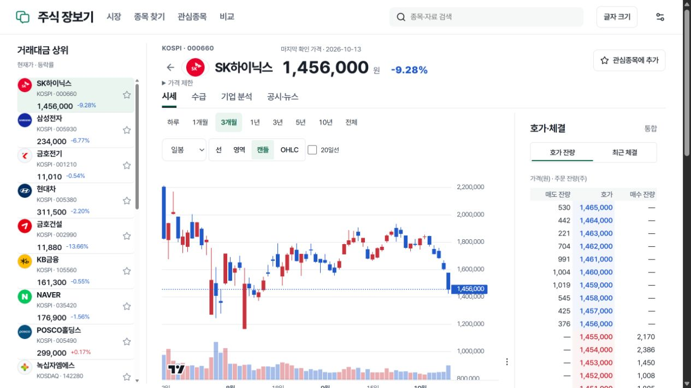

# v136–v139 구현·공개 검증 기록

2026-10-13 KST. 공개 실행 버전: **20261013-lucian-date-v139**. 배포 소스: `ecae992b7c7acf40d6c109191721a3985a24d30f`. 이 기록은 전체 계획 완료 선언이 아닙니다. 디렉터리 이름은 최초 검증 단계의 v136을 유지합니다.

## 공개 반영

- API·공유 작업자, Nginx 정적 화면, Cloudflare 정적 화면을 같은 release로 반영했습니다. PostgreSQL·Redis·OpenAlgo와 다른 서비스는 재시작하지 않았습니다.
- 최종 CI 산출물을 배포했습니다. VPS·Cloudflare 공개 manifest는 로컬과 동일하며 SHA-256 `6a723bc3db504cd94d0a81fa7e7ddad09ba10d0092cdcac2492fb7d4171be897`, 파일 75개입니다. 이전 Windows 후보의 77개와 Linux CI의 75개 차이는 생성되는 RSC 파일 이름 구조이며, 최종 후보의 자산 참조·무결성 검사는 통과했습니다.
- API health의 release가 일치합니다. 내부 경로와 주문 경로는 공개 요청에서 404입니다. 이는 접근 통제의 해당 경로 확인이며 전체 보안 검사 통과가 아닙니다.
- 기존 주소·관심종목·설정·공유 링크를 유지했습니다. 앱 롤백 자료는 보존했지만 이번 턴에 실제 롤백은 실행하지 않았습니다.
- 22:18 KST HTTP 확인은 두 주소의 manifest·종목 JS·API release와 내부/주문 경로 404를 대조했습니다. [공개 확인 결과](public-v139-smoke.json), [배포 커밋·이미지·자산 기록](deployment-v139.json). 운영 release에도 인증값 없는 `source-revision.json`을 남겼습니다. HTTP 확인은 장중 수신·부하 시험이 아닙니다.
- v139에 이전 release의 provenance marker가 복사된 것을 발견했습니다. v138 원본과 바이트 동일성을 확인한 뒤 v139 marker만 올바른 커밋·자산 정보로 원자적으로 교체했습니다. 이전 release는 보존했습니다. 후속 운영 도구 커밋 `4fc1e43`은 다음 배포에서 이 marker를 복사하지 않도록 수정했으며 65개 관련 fixture와 F lint를 통과했습니다. [도구 반영](operational-helper-update.json)은 앱 소스 `ecae992`와 별도입니다.

## 기능 상태

| 항목 | 구현 | 실제 자료 | 화면 검증 | 공개 반영 |
|---|---|---|---|---|
| 목록·캔들·호가 작업 화면, 키보드 크기 조절 | 완료 | 대표 종목 확인 | 자동 fixture＋공개 PC | v139 |
| IME 검색, 비교 모드, 관심 취소, 영역별 실패 복구 | 완료 | 기존 저장 자료 유지 | 자동 fixture | v139 |
| 날짜·확대 범위 보존, 기간 메타데이터 | 완료 | 삼성전자·셀트리온 실제 API | 자동 fixture＋공개 PC | v139 |
| 동일 기준의 넓은 가격 이력 선택 | 완료 | 대표 종목 확인 | API·차트 | v139 |
| 커서 검증·최신/과거/공백 분리 | 완료 | 실제 페이지 canary, 종단 미확인 | 관련 fixture | v139 |
| 전 종목 가격 이력 복구 | 진행 불가 | 공간 제한·과거 커서 남음 | 전체 완료 미통과 | 작업자만 반영 |
| 재무 실제 기간·공개 시각·증감 검증 | 완료 | 기존 기간 입력 사용 | 관련 fixture＋공개 3연도 표 | v139 |
| 전 기업 TTM·분할·배당 근거 확대 | 미완료 | 기존 확보 범위 유지 | 전 종목 미통과 | 기존 범위 |
| 후보 30종목 이하 검색·종목별 캐시 | 완료 | 기존 값 계약 확인 | 관련 fixture | v139 |
| 실시간 반영 묶음·정확한 수신 frame 보존 | 완료 | v136 수신값 확인, v138 장중 미검증 | offline fixture | v139 |
| VPS 공간·전체 복원 | 미완료 | 정리 약0.36GiB, PC 최소 여유 가드 중단 | 전체 RESULT 실패 | 운영 전환 없음 |
| 공개 성능 목표 | 미달 | 100 HTTP/2 연결·오류 0건 | API 시험 | 동일 v137 |
| 실제 Android/iOS·아버님·5명 사용 평가 | 미검증 | 해당 없음 | 자동 시험으로 대체하지 않음 | 해당 없음 |

## 검증

- 가격·페이지·backfill·조회·분석 관련 fixture 312개 통과. 이후 focused 시험은 같은 영역이 겹치므로 합산하지 않습니다.
- 후보 검색 fixture 68개 통과. 실시간 원문·반영·복구 offline fixture 30개 통과.
- 재무 기간·공개 시각 fixture 및 회계연도 표시 Node 17개 통과. 계산 불가를 0으로 만들지 않는 사례를 포함합니다.
- v136 화면의 Playwright 선택 시험 50개 통과: 360/390/430/768/1024/1280/1440/1920px, 200%, 다크, 동작 줄이기, IME·탭·패널·날짜·관심 취소. 실제 휴대폰 검증은 아닙니다.
- 최종 [CI 38401937553](https://github.com/pollmap/luxon-investment-terminal/actions/runs/38401937553)는 배포 소스 `ecae992`에서 통과했습니다. Python **2,836 passed·22 skipped·4 deselected**, Node **169 passed**, Playwright **50 passed**, 타입·정적 빌드·자산/PWA 검사 통과입니다. 제외/건너뜀을 실행 성공으로 세지 않습니다. 로컬 lint는 exit0이며 기존 경고 2개, CI에는 기존 Starlette/HTTPX·Node module 안내 및 runner 전환 안내가 남습니다.
- 앞선 CI 실패도 보존합니다. 38393429710은 projection 필드 수 기대값과 비UTF8 원문 처리 실패, 환경변수 전달 누락으로 release가 `local`인 후보였습니다. 38396512257은 강화된 영수증 조건을 충족하지 않은 모의 원문과 기존 거래 완료 이력 보존 회귀로 29개 실패했습니다. 모의 원문을 실제로 보관하는 시험 helper와 legacy 주장/검증 근거 분리, 비UTF8 원문 보존, 격리 빌드 release 전달을 수정한 뒤 최종 전체 CI를 다시 통과했습니다. 실패 후보는 배포하지 않았습니다.
- 공개 PC에서 실제 3개월 일봉 캔들·거래량·호가와 시세→기업 분석 왕복을 확인했습니다. 기업 분석의 EPS/OCF/EBITDA 선택과 비교 가능 기간, 2023/2024/2025 표를 확인했습니다.
- v138 공개 점검에서 OCF→EPS 전환이 실제 가격 날짜10월13일을 비교 가능 날짜10월8일로 자동 이동시키는 결함을 발견했습니다. v139는 실제 가격 날짜를 유지하며 해당 날짜의 미검증 실적은 `—`로 표시합니다. 공개 PC에서 전환 완료 후 날짜 유지, 사용자가 ‘비교 가능한 최근 실적 보기’를 눌렀을 때만10월8일로 이동, EPS231,198.91·15배3,467,984원의 표시를 확인했습니다. 기존 탭의 새 버전 안내→새로고침에서 회사·기업 분석 탭·EPS·5년 선택 복원도 확인했습니다. 실제 휴대폰 검증은 아닙니다.

## 가격 확보 범위

v137 공개 `prices?all=true` 확인:

| 종목 | 실제 저장·표시 | 과거 수집 | 무결성 검증 |
|---|---|---|---|
| 삼성전자 005930 | 1975-06-12~2026-10-13, 13,752봉 | 기존 완료 상태이나 종단 영수증 없음 | 미검증 |
| 셀트리온 068270 | 2025-02-13~2026-10-13, 405봉 | older pages pending | 미검증 |

삼성전자의 기존 ready/history_complete를 전체 검증 완료로 승격하지 않습니다. 셀트리온의 짧은 범위를 전체 이력처럼 표시하지 않습니다. 최신 저장 기간과 과거 커서를 별도로 전달합니다.

## 공개 성능

Windows PC 공개 인터넷, 100개의 독립 TLS/HTTP2 세션, 세션당 동시에 한 요청, 검색어·종목 각 10개, 총 1,000요청입니다. DNS/TCP/TLS 연결 수립은 따로 기록했고 아래는 연결 재사용 후 전체 응답 수신까지입니다. 첫 요청은 cold를 보장하지 않고, warm은 cache hit를 보장하지 않습니다. 작업자는 켜져 있으며 v137 시험은 장 마감 후입니다.

| 구간 | 검색 p95 | 상세 요약 p95 |
|---|---:|---:|
| 최초 100요청 | 6,782.92ms | 860.46ms |
| 후속 300요청 | 1,483.72ms | 531.78ms |
| 1.6초 대기 후 100요청 | 4,555.54ms | 1,627.31ms |
| 목표 | 300ms | 500ms |

**두 목표 모두 미달입니다.** 검색 warm 적중은 20/300이며, 만료 280/300입니다. 가격 TTL을 늘리지 않았습니다. 광범위 검색의 전체 시장 경로·식별 색인 버전·직렬화/잠금과 인터넷 지연을 후속 원인으로 기록합니다. 서로 다른 조건의 이전 측정과 단순 비율로 10배 개선을 주장하지 않습니다. LCP·INP·CLS 및 수집 중단 비교는 이번에 검증하지 않았습니다.

## 실시간·보안·공간

- 10월13일 실제 NXT 세션에서 삼성전자·SK하이닉스의 체결·호가 값/topic/KRW/source_at/received_at와 저장 표현의 SHA를 확인했습니다. 구독 승인만으로 세지 않았습니다. **당시 SHA는 JSON을 다시 직렬화한 저장 표현의 해시였으며, 정확한 수신 frame 바이트의 해시라고 주장하지 않습니다.**
- v138은 JSON 해석 전에 원래 frame을 한 번 보존하고 그 SHA를 반영기로 전달합니다. 공백·한글·비UTF8 바이트의 회귀 시험을 통과했습니다. v136 일부 관측은 약0.2초 수신이었으나 이후 217~237초 지연이 확인됐습니다. fresh 조건 미통과로 강제 단절 시험을 실행하지 않았습니다. v138은 장 마감 후 배포됐으므로 새 코드의 실제 세션 수신·강제 복구·브라우저 반영은 미검증입니다.
- 서비스 소유와 비활성 상태를 재확인한 임시 압축본17개를 삭제했습니다. 가용 공간은 4,610,949,120→5,000,654,848B로 증가했습니다. 원본·DB·고유 백업·미검증 복원·다른 서비스·공용 Docker 자원은 보존했습니다. VPS80% 미만 조건은 충족하지 못했습니다.
- 21:54 KST 재조회는 VPS 사용률 **98.14%**, 가용 **2,864,877,568B**, 80% 미만까지 추가 **28,097,182,926B(약26.17GiB)**가 필요했습니다. 정리 당시 확보량을 현재 가용량으로 재사용하지 않습니다. API·작업자 정상 기동, 다른 서비스 상태 유지, 기존 hongong unhealthy 상태는 주식 배포로 해결했다고 표시하지 않습니다.
- 최종22:23 KST 재조회는 사용률 **98.30%**, 가용 **2,613,596,160B(약2.43GiB)**, 80% 미만까지 추가 **28,348,464,334B(약26.40GiB)**입니다. 실제 배포 명령의 재시작 대상은 주식 API·작업자뿐입니다. 별도 coin 서비스의 기동 시간이 바뀐 관찰도 있어 다른 모든 서비스가 같은 컨테이너로 유지됐다고 확장 주장하지 않습니다.
- PC의 정지된 테스트 DB 사본 보존 압축은 30분 예산으로 중단됐습니다. 361/1,732파일 처리, 완전 manifest·해시 검증 없음, 원본과 partial 보존, 삭제·자동 재시도 없음.
- PC의 중복 정적 빌드76파일·24,402,209B는 남길 CI 사본과 전 파일 SHA가 같음을 읽기로 확인했습니다. 자동 승인 검토가 초기 삭제 명령과 별도 해시 검사 뒤의 정확한 절대 경로 삭제를 모두 `blocked by policy`로 거부했고 세부 이유는 제공하지 않았습니다. 삭제0건·회수0B이며 다른 도구로 우회하지 않았습니다. [차단 기록](pc-duplicate-cleanup.json).
- 새 독립 복원은 20:30KST 시작했습니다. 전체17,014,175행·8,071참조·ordered hash·source refs·원본 SHA를 요구합니다. 예산은 4시간·소유 클러스터 추가6GiB·소유 클러스터 전체16GiB·C: 최소 여유4GiB입니다. 전체 드라이브의 여유 감소와 해당 클러스터 증가를 구분합니다. 시작·checkpoint는 통과 결과가 아니며 최종 RESULT를 별도로 기록합니다. 시간 상한은 **10월14일00:30KST**입니다.
- **실제 최종 RESULT는 interrupted·restore_verified=false·data_equal=false**입니다. 6,156.422초 뒤 C: 여유4,293,443,584B가 최소4,294,967,296B 아래로 내려가 중단했습니다. 소유 클러스터는9,499,955,169→9,400,112,731B로 줄었고 전역 여유는8,082,067,456B 감소했습니다. 감소 원인을 외부 빌드·OS·복원 밖 임시 파일 중 하나로 단정하지 않습니다. exact count의 기존15,282,400행·8,071참조와4개 인덱스 계획은 확인했으나, 이번 대조는4,262,400행까지이며 전체 정렬 해시·원천 참조 검증은 미통과입니다. 복원 CLI exit1, 부모 PowerShell exit0을 구분합니다. 클러스터 정상 종료·원본/입력 보존·운영 미접촉, 자동 재시도 없음. [결과 요약](restore-result.json), [재생 처리 감사](../20261013-v139/RESTORE_REPLAY_REVIEW.md).
- GitHub braces 경고 #27은 공식 수정 버전이 없고 대체 후보의 61검사 중1개가 실패해 미해결로 유지합니다. 운영 정적 파일의 개발용 ESLint 의존성과 공개 API 노출을 구분합니다. 상세: [보안 기록](SECURITY_BRACES.md).

참고: [구조 결정](DECISIONS.md), [저장공간 조사](STORAGE_AUDIT.md), [보존 압축 실제 결과](STOPPED_CLUSTER_ARCHIVE_RUN.md).

공개 화면: https://stocks.62-171-141-206.sslip.io/stocks

