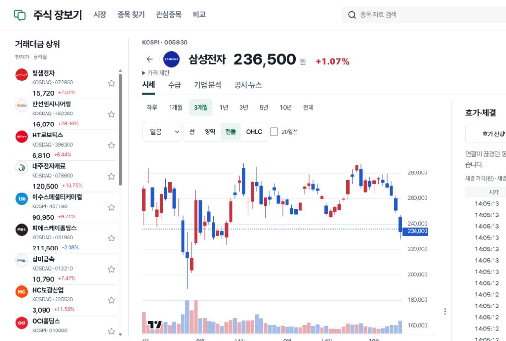
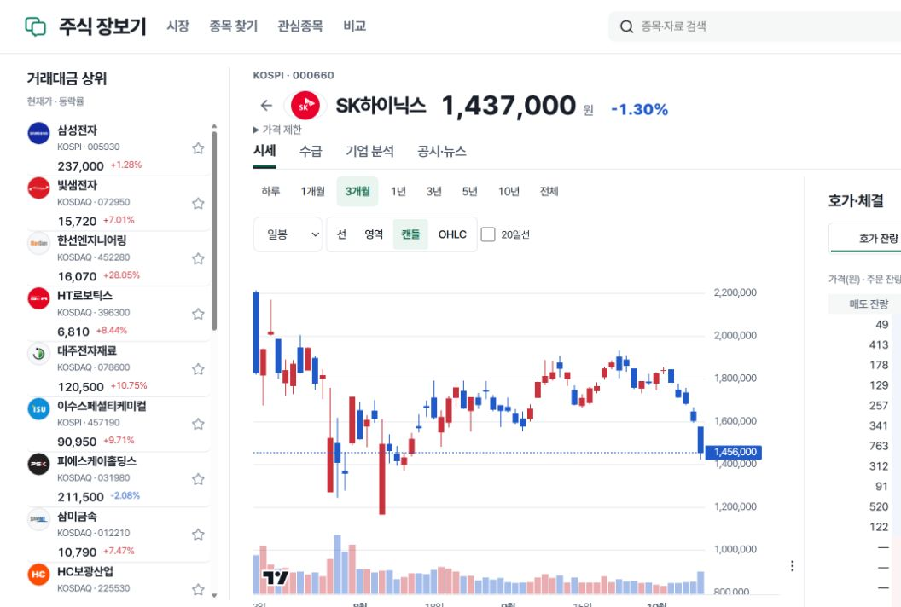

# 10월14일 토스 장중 검증 — 도구 결함으로 미통과

예약은09:10 KST였으나 heartbeat는13:56:26 KST에 도착했습니다. 실제 정규장 중13:58~14:10에 한 번 실행했습니다. 현재 API/공유 작업자와 공개 health·정적 manifest는 모두 **20261014-search-lock-v141**입니다.

저장된 공식 KR 일정 원문 SHA `46ee9cc663f774d5def76ae8b676256902e1c1fbe933a563fc623cd670e99caf`를 바이트·메타·snapshot 값으로 대조했습니다. 정규장은09:00~15:30 KST, 통합 기준 pre08:00~09:00/after15:30~20:00입니다. 관측 시점은 정규장에 해당했습니다.

## 서버 증거와 실패 경계

기존 market-api 컨테이너에 현재 capture 소스를 stdin으로 전달했습니다. 새 Store/스키마/공급자 요청·연결은 만들지 않았습니다. 첫13:58:50/13:59:11 KST repeatable-read READ ONLY 두 snapshot은20.11초 간격이며, 삼성전자·SK하이닉스의 체결·호가4개 당일 증거가 `evidence_identity`로 미확인, 메시지 증가0, `both_kinds_observed=false`였습니다. CLI 종료0을 통과로 사용하지 않았습니다.

공개 두 종목 화면을 조회한 뒤14:07:26에 마지막3번째 snapshot만 읽었습니다. 공유 상태는 `receiving`, 두 종목4topic은 모두accepted였으나4개 원문 검사는 `evidence_unreadable`로 실패했습니다. 따라서 **실제 원문 수신 gate·REST 복구·단절 복구는 미통과**입니다. epoch는 그대로이며 시장이 닫혔다고 원인을 바꾸지 않습니다.

코드를 대조해 검증 도구의 확실한 불일치2개를 찾았습니다.

1. 현행 `Store.raw`는 UTF-8 toss-stream frame을 create-only JSON envelope의 payload에 바이트 그대로 보존하며 .bin을 중복 생성하지 않습니다. 검증의 `original`은 .bin/.bin.gz만 찾아 envelope-only reader가 없습니다. `raw_archive.read_original_verified`가 이미 지원하는 형식을 이 도구만 읽지 못합니다.
2. 실제 receiver는 metadata URL을 WebSocket 수신 endpoint로 기록합니다. 검증의 `evidence`는 metadata URL을 `trade:kr:종목` 또는`orderbook:kr:종목`과 같아야 한다고 검사합니다. fixture/legacy direct caller의 topic archive와 실제 receiver archive를 혼동했습니다. topic은 실제 raw frame에서, endpoint는 metadata에서 각각 검사해야 합니다.

두 결함은 현재 수신을 검증하지 못하는 **거짓 실패 가능성**입니다. 원문이 손실됐다는 결론이나 공급자 장애로 확정하지 않습니다. 보조검사도 같은 기존 reader에서 실패했으므로 원문 SHA·source_document_id·통화·source_at/received_at 전체 binding을 실제 통과했다고 처리하지 않았습니다. heartbeat의문서만 변경 범위에 따라 도구/제품 코드는 고치지 않았습니다.

`recovery ready` 역시 원문 REST 값 대조 증거가 아닙니다. 기존 snapshot 함수는 빈 호가/체결도 no_data로 저장하고 반환할 수 있으므로, 다음 개발에서 원문·종목·epoch·기준 시각까지 확인해야 합니다. 이번3번째 관측은 첫 pair와180초 넘게 떨어져 있어 pair 비교를 확장하거나 재시작 전후 증거로 사용하지 않았습니다.

## 공개 브라우저 — 별도 결과

공개 화면의 삼성전자 가격235,750→236,500원과14:04:23 체결 목록, SK하이닉스1,448,000→1,436,000→1,437,000원과14:10:09 체결 목록을 직접 확인했습니다. 두 종목 모두 호가 표도 표시됐습니다. 이것은 **화면 값이 갱신됐다는 증거**이며 검증된 원문→해당 UI 갱신의 binding 증거는 아닙니다. REST와 WS 경로를 분리해 입증하지 못했으므로 실시간 전체 통과로 세지 않습니다. 연결 공백 안내도 표시됐고 무손실 수신을 주장하지 않습니다.

SK하이닉스의 유의사항 갱신 실패·마지막 자료 안내, 현재 가격과10월13일까지의 일봉 구간도 관찰했습니다. 이 heartbeat에서 재무/과거자료/유의사항을 수정하거나 화면 전체를 검수한 것은 아닙니다. 실제 CSS viewport1280×720이며 실제 휴대폰 시험이 아닙니다.

## 종료와 다음 한 가지 조치

**캡처 reader의 JSON-envelope/실제 수신 endpoint 계약과 회귀검사를 먼저 수정한 뒤, 별도 승인된 장중 검증에서 baseline pair→조건부 작업자 재시작→REST 원문/새epoch/후속 frame/UI binding을 다시 확인해야 합니다.** 이번에는관측3회상한으로 종료했고 작업자/API/DB/Redis/다른 서비스를 재시작하지 않았습니다. 새vendorWS·키·주문·계좌 호출0, 삭제·복원·수집 확대0, 제품코드변경0이며 자동 재시도/새 반복 예약은 만들지 않았습니다.

인증값과 원문 전체 없이 [상세 관측·검증 경계](live-20261014-result.json)를 저장했습니다. 결과 문서와 공개 화면 증거만 현재 서비스 GitHub 브랜치에 반영합니다. 원본과 기존 사용자 변경은 보존합니다.
