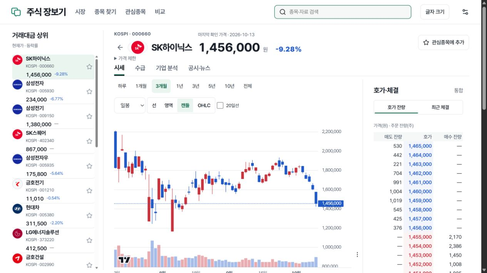

# v141 공개 반영·실제 검증

2026-10-14 KST. 공개판은 **20261014-search-lock-v141**, 제품 소스는 `8e1288b66d00050b56d5c7d42400763140551415`입니다. [기존 공개 주소](https://stocks.62-171-141-206.sslip.io/stocks)와 [Cloudflare 정적 화면](https://korea-stocks-edge.lch68-workers.workers.dev/stocks)의 manifest·대표 JS·API 버전을 실제 대조했습니다. 문서·운영 변수 커밋은 제품 소스와 구분합니다.

## 이번 변경

- 검색의 긴 SQL·디코딩 작업과 짧은 cache publication 잠금을 분리했습니다. 다른 원천의 SQL이 이미 확보된 정확한 식별 세대의 조회를 가로막지 않게 했습니다.
- 종목 일치 판단에 사용한 값과 그 값을 읽었을 때의 버전을 함께 보존합니다. 동시 writer가 cache를 교체해도 이전 값을 새 버전으로 표시하거나 캐시하지 않습니다.
- PostgreSQL 식별 projection의 JSONB 변환을 한 번 평가하도록 `MATERIALIZED`를 적용했습니다. 실제 실행계획의 효과만 따로 확정한 실험은 아닙니다.
- 복원 도구는 소유 PG17·UTF8·기본 C collation·실제 파라미터별 계획을 확인한 경우에만 고정 최종 정렬3개를 PK 정렬로 전달합니다. frozen canonical/hash·모든 행·source-reference 검증과 자원 한도는 유지했습니다. **실제 복원을 다시 시작하지 않았습니다.**

상세 요약의 필드 제한·종목별 버전, 가격 TTL·유효 기간, 기존 API·공유 링크·관심종목·설정을 유지합니다. [변경과 동시성 회귀](PERFORMANCE_CHANGE.md), [복원 진단·어댑터 경계](../20261013-v140/RESTORE_FAILURE_DIAGNOSIS.md).

## 검증과 배포

[전체 CI](https://github.com/pollmap/luxon-investment-terminal/actions/runs/38422894057): Python **2,937통과·22skip·4deselected·경고1**, Node111·Worker/계측58·브라우저50·타입·정적 자산/PWA 검사 통과. 검색52·복원217의 선택 fixture와 독립 읽기 검토를 추가했습니다. fixture와 코드 검토는 실제 원천·전체 복원·사용자 평가의 대체 증거가 아닙니다.

API와 공유 작업자만 새 이미지로 교체했습니다. PostgreSQL·Redis·OpenAlgo·다른 VPS 서비스를 재시작하지 않았으며 금융 원본·운영 DB·부분 복원을 삭제하지 않았습니다. VPS 정적 자산과 Cloudflare 자산도 같은 버전입니다. 현재와 최근 정상 배포2개, v131 호환 경로와 reader floor를 보존합니다. [배포·해시](deployment.json), [선택 공개 경로·검색 검사](public-smoke.json).

처음 시도한 `pnpm exec`가 package-manager 자동 준비 과정에서 종료값3221226505로 실패했습니다. 같은 설치를 반복하지 않고 기존 검증에 사용한 설치된 Wrangler **4.148.0**을 Node24.18.0으로 직접 실행해 배포했습니다. 새 토큰·설치·권한 발급을 하지 않았습니다. API 교체 중 한 health probe는 JSON으로 해석되지 않았고, 직후200·v141과 최종 공개 검사가 통과했습니다. 무중단 전환 검증으로 표현하지 않습니다.

실제 PC 브라우저에서 기존 탭의 새 버전 알림→상태 보존 갱신, 하이닉스 검색→000660 상세→3개월 일봉 캔들·거래량·호가 표시를 확인했습니다. 실제 viewport는1265×712입니다. 모바일·모든 폭·아버님 실사용·장중 새 수신 완료를 뜻하지 않습니다. [브라우저 기록](browser-validation.json).

## 공개 성능: 개선과 미달을 분리

Windows PC 공개 인터넷·HTTP/2 독립100연결·연결당 동시1요청·10검색어/10종목·총1,000요청. 수집 작업자on·휴장·과거 수집capacity_limited, 복원/색인/로컬 빌드 동시 실행없음입니다. 기존 공개 탭의 일반 polling은 통제하지 않았습니다. 연결 수립은 요청 시간과 분리했고, 오류는0건입니다. `warm`은 후속3배치 명칭이며 HIT만을 뜻하지 않습니다.

| p95 본문 수신 종료 | v139 | v140 | v141 | 목표 |
|---|---:|---:|---:|---:|
| 검색 첫 배치 | 9,576.48ms | 7,454.30ms | **4,188.32ms** | 300ms |
| 검색 후속3배치 | 1,830.33ms | 4,215.21ms | **1,455.72ms** | 300ms |
| 검색1,600ms 뒤 | 1,073.79ms | 2,285.83ms | **2,223.95ms** | 300ms |
| 요약 첫 배치 | 779.92ms | 820.66ms | **662.39ms** | 500ms |
| 요약 후속3배치 | 1,482.78ms | 600.43ms | **535.97ms** | 500ms |
| 요약1,600ms 뒤 | 579.48ms | 563.64ms | **578.92ms** | 500ms |

**두 목표 모두 미달입니다.** v140 검색 회귀는 줄였지만, 만료 검색은v139보다 여전히 느립니다. 후속 요약만35.97ms 차이라고 통과로 처리하지 않습니다. v141 검색 후속의 EXPIRED200/HIT100 중 현재 app p95는1,090.70ms, 요약은EXPIRED190/HIT110 중199.74ms입니다. HIT의 과거 app 시간은 현재 통계에서 제외했습니다. HIT 검색310.02ms·요약291.21ms를 전체 결과로 선택하지 않습니다. 독립 p95끼리 빼서 네트워크만의 시간을 만들지 않습니다.

같은 원인의 수정·재측정 상한을 적용해 **자동 반복 시험은 중단**합니다. 다음 설계에서는 식별 일치 계산의 반복, response stripe 충돌, 미계측 app 대기, 실제 DB 계획을 분리해 원인을 좁혀야 합니다. 이번 기록으로 원인을 하나로 확정하거나 유료 리전 이전을 실행하지 않습니다. [전체 단계·캐시·연결 조건](performance-public.json), [v140 실패](../20261013-v140/performance-after-v140.json), [v139 기준선](../20261013-v140/performance-before-v139.json).

## 공간·복원·자료의 남은 조건

v140에서 비활성8배포본의 외부 사본·14,878파일 해시·앱 배포본1개 복원을 확인하고 정리했습니다. 논리 합1,789,319,166B를 물리 회수량이라고 보고하지 않습니다. [정리 증거](../20261013-v140/release-cleanup.json).

v141 공개 검증 시 VPS 가용은**7,550,435,328B (7.03GiB)**, 80%미만까지 추가 약**21.82GiB**입니다. 이전00:19 관측 가용3.41GiB와 다르지만, 동시 운영 쓰기·임시 할당 변화를 모두 특정 정리의 성과로 계산하지 않습니다. 주식 DB 약41.5GB의 대부분은 시계열·재무 사실이고, 그 크기를 불필요한 중복이나 bloat로 판정하지 않았습니다. 원본을 지우거나 기준을 올려 수집을 재개하지 않습니다. [현재 사용 위치·안전한 삭제 한계](../20261013-v140/STORAGE_NEXT_BOUNDARY.md).

독립 복원은00:00 KST에 최소 여유4GiB 방어선으로 중단됐습니다. 기존 checkpoint exact15,282,400행·8,071참조는 일치했지만 이번 replay4,226,800행은 전체17,014,175행·최종ordered hash·source refs 통과가 아닙니다. 소유 PG 종료 후 공간이 회복됐으며, 일시 할당의 원인은 미확정입니다. 같은 전체 복원은 재실행하지 않았고 현재 운영 변경분도 별도 검증이 필요합니다. [실제 RESULT 요약](../20261013-v140/restore-observation.json).

- 가격 이력:2,761대상 중 데이터 존재와 정상 종단·전기간 값 검증은 별개입니다. 과거커서2,155개라는 앞선 메타를 완료율로 바꾸지 않습니다. 094800의404를 숨기기 위해 종목을 제외하지 않았습니다.
- TTM/분할/배당: 주식 단위 스냅샷5개는 전종목 TTM 완료 수가 아닙니다. 이번에는 최초 검토 구절의 원문 일치와 조회 정합성을 보완했고, 새 기업의 검증된 입력을 추가한 것은 아닙니다. 배당금·권리일·배당락일·지급일 공백을 서로 복사해 채우지 않습니다. [제한적 메타 감사](../20261013-v140/financial-metadata.json).
- 실제 장중: **10월14일09:10 KST 한 번**의 공유 작업자·원문/세션·공개 화면·단절 복구 검증을 유지합니다. 야간 호가 표시는 새 장중 이벤트의 증거가 아닙니다.15분/최대3회 관측, 새 vendor 연결·주문·계좌 호출·API/DB/Redis 재시작은 제외합니다.
- 보안: 기본 브랜치의 braces 경고27은 공식 수정 버전 부재로 남습니다. 전체 보안 검사 통과나 경고 해결로 표현하지 않습니다.
- PC 캐시 삭제: 경로·소유·참조를 검사했지만 자동 승인 검토가 정책으로 거부했습니다. 실제 회수0B이며 삭제 경로를 우회하지 않았습니다.

**전체 완료는 아닙니다.** 공개·GitHub에 반영한 검증된 수정과, 전종목 과거자료·TTM/분할/배당 확대·전체 복원/운영delta·성능 목표·실제 장중·모바일/실사용의 미완료를 분리합니다.
