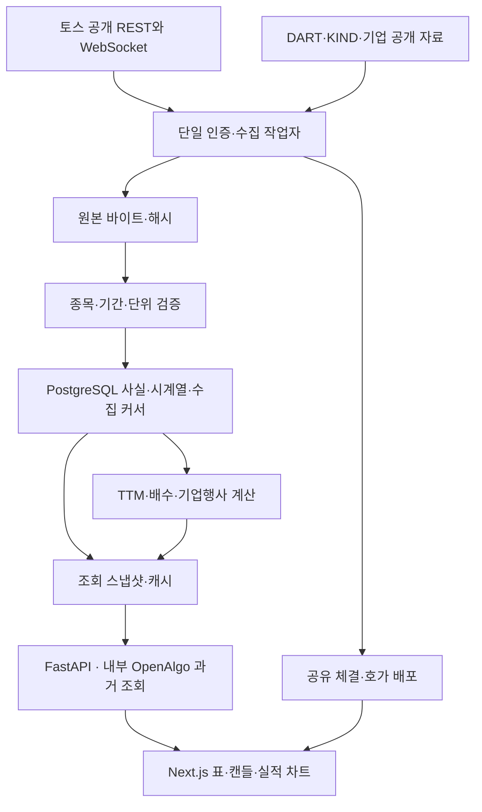

# 토스 단일 연결 구현·검증 기록

기준일: 2026-10-03. 공개 서비스: https://stocks.62-171-141-206.sslip.io/stocks

최종 공개 버전은 `20261003-toss-single-v22`, 웹 빌드는 `5wLpUmuFp3y2sq8EN3081`이다. 핵심 API·수집기 파일의 로컬/운영 SHA256과 실행 중 웹 빌드가 일치한다. 배포 묶음 SHA256은 `898f65adad58b73d9f6195abe9d15305fc90ffcccbae5231624947548459f3cc`다.

## 결과와 남은 완료 조건

증권사 실행 경로를 토스로 단일화했다. 키움·한투 수집·인증·대체 호출·환경변수·배포 분기를 제거하고 DART·공개 기업 자료·기존 사용자 저장값은 보존했다. 공개 시장 GET 20종은 실제 응답과 원본 해시를 확인했다. 이는 모든 종목·모든 요청 조합의 검증을 의미하지 않는다.

**전체 완료는 아니다.** 전 종목 과거 페이지, 주식분할 기준까지 검증한 TTM EPS, 기업행사 전 구간과 배당 재투자, 실제 장중 스트림, 아버님 사용 평가가 남았다. WAN 부하 목표도 아직 미달이다.

| 묶음 | 구현 | 실제 자료 | 화면 검사 | 공개 반영 |
|---|---|---|---|---|
| 토스 단일 실행 | 완료 | 운영 설정·모듈 및 DB 감사 | 기존 검색·상세 유지 | 반영 |
| 공개 조회 20종 | 연결 | 각 API 대표 응답·해시 확인 | 순위·금리·일정·시세·수급 대표 사례 | 반영 |
| 공유 체결·호가 구독 | 구현 | 30개 구독 승인, 신규 장중 이벤트 미확인 | REST 체결·호가 표시 | 반영, 장중 검증 미완료 |
| 과거 가격·거래 자료 | 커서·재시도·정규화 저장 | 전체 순환 수집 중 | 삼성전자 1,844일 수급·장기 캔들 | 반영, 전체 기간 미완료 |
| TTM EPS | 귀속이익·가중평균 주식 수 계산 | 33개 입력 대조, 15개 TTM 후보의 분할 기준 미확인 | 공시 EPS와 계산 불가 사유 | 반영, 검증된 비교선 없음 |
| 배당·기업행사 | 원문 수집·수량/현금 계산 | 삼성전자 배당 기록 8건, 권리·배당락·전체 행사 미완료 | 지급 이력·원문 링크 | 반영, 총수익률 제한 |
| UX | 수급 메뉴 통합·저장·차트·테마 | 실제 자료 사용 | PC 4개 폭, 큰 글씨, 테마, 저장 취소 | 반영, 아버님 실사용 미확인 |
| 운영 | 백업·복원·재개·배포 | DB 복원·암호화 사본 확인 | 공개 주소 확인 | 반영 |

## 변경 사항

- `authenticated_sources.py`에서 DART를 분리 보존하고, 작업자는 토스 수집기만 시작한다. 제거 목록은 `ops/market/retired-files.json`에 관리한다. 이전 이미지의 삭제된 모듈이 COPY로 되살아나지 않게 배포 시 해당 모듈 디렉터리를 교체한다.
- `retire_providers.py`는 삭제 전 SHA256으로 확인한 백업을 요구한다. 운영 DB 검사에서 레거시 전용 작업·필드 일치 건수는 0건이었으며, 원래 자료를 임의로 지우거나 출처를 토스로 바꾸지 않았다.
- 공개 시장 API는 허용 목록으로 제한한다. 개인 계좌·보유자산·주문 경로는 인증 요청 전 거절한다.
- 현재가는 최대 200종목씩 묶고, 과거 자료 조회와 독립된 5초 REST 갱신 작업으로 제공한다. 400/404를 반환하는 종목은 묶음을 분할해 다른 종목 갱신을 유지하고 재시도 시간을 둔다. 실제 WebSocket 수신과 이 REST 갱신은 별개다.
- 토큰 공유, HTTP 401 재발급 1회, API 그룹별 예산, 숫자 및 HTTP-date 형식의 Retry-After를 처리한다.
- 재연결 구독 시작과 종목별 REST 복구 작업을 분리했다. 새 연결의 승인·거절 목록과 epoch를 초기화하며, 체결 방향·누적량·공급자 순서번호를 만들어 넣지 않는다.
- 가격·거래 이력 행과 수집 커서를 동일 DB 트랜잭션에 저장한다. 정정된 일부 행은 기존 수십 년 자료를 보존하며 변경 행만 갱신한다. 실패하면 행과 커서가 함께 롤백된다.
- 과거 수집은 조회한 종목을 매 5회 중 1회 우선 처리하고 전체 종목 순환을 유지한다. 배당 성과 요청은 원주가 수집을 우선 요청한다. KST·UTC 체크포인트는 문자열이 아닌 실제 시각으로 비교한다.
- EPS `3834`와 `3834.0` 표기 차이 때문에 대조 결과가 달라지던 문제를 수정했다. 동일 값의 사실 선택도 입력 순서에 의존하지 않는다.
- 자회사 공시를 모회사 배당으로 해석한 기존 1건을 격리하고 원본·이전 해석을 보존했다. 정정 공시의 원본 이벤트는 성과에 중복 적용하지 않는다.
- 수급 내부를 투자자 / 거래원 / 프로그램 / 공매도 / 대차·신용 한 줄로 정리하고 선택값을 링크와 종목 설정에 보존한다. 긴 차트의 별도 모드 행을 기간 선택에 합쳤다.
- 관심 저장 취소는 시간 제한 때문에 사라지지 않도록 변경했다. 처음 공시를 받는 동안 오류 문구가 먼저 나오던 문제도 수정했다.

## 구조

## 데이터 확보 상태

`toss-single-coverage-v20.json`은 전체 2,875종목의 **수집 작업 메타데이터**를 집계한다. 기존 공개 자료 전체의 확보율과 동일하지 않다. 원천 마지막 페이지 수신도 중간 거래일 무결성 검사를 대신하지 않는다.

2026-10-03 08:44 UTC 부근 감사에서 일봉 마지막 페이지 확인은 74종목, 투자자 34종목, 프로그램 49종목, 공매도 거래 142종목, 신용 38종목, 대차 28종목이었다. 자료 종류별 109~110종목은 토스 HTTP 404로 남아 있고, 대부분 종목은 이전 페이지 수집 중이다. 원주가는 이미 저장된 대표 종목이 있어도 전체 순환 작업 행이 아직 없으므로 0건 작업으로 집계됐다.

삼성전자의 조정 방식이 원천 기준인 일봉 13,747건(1975-06-12~2026-10-02), 투자자 1,844일(2019-04-01~2026-10-02)은 실제 저장 및 화면을 확인했다. 원주가·신용·대차의 과거 커서는 남아 있다. 총 시도 횟수를 수집 완료 종목 수로 사용하지 않는다.

## 테스트와 화면

- 대시보드 전용 Python 테스트 **211개 통과, 실패·누락 0건**(39.115초), TypeScript 검사 및 Next 프로덕션 빌드 통과. 린트 오류 0개, 기존 경고 11개다. 전용 XML 결과를 함께 보관한다.
- 레거시 터미널의 `tests/api`, `tests/normalize`까지 포함한 광역 실행은 해당 선택 의존성 matplotlib가 없어 수집 단계에서 중단됐다. 이 테스트를 통과했다고 보고하지 않는다.
- 공개 화면에서 실제 검색·일봉/월봉 캔들·거래량·전체 수급·프로그램 표·기업 분석·관심 저장/취소를 확인했다. 지표 설명을 닫으면 PER 버튼으로 초점이 돌아왔다. 저장 후 10초 이상 지난 뒤에도 취소가 가능했고, 시험용 관심 저장은 취소했다. 글자 크기·테마는 원래 선택으로 복원했다.
- PC 1024·1280·1440·1920px 차트 화면은 문서 가로 넘침이 없고 종목 헤더는 `position: static`이었다. 1024px 라이트·더 큰 글씨도 가로 넘침이 없었다. 이것은 전체 페이지 접근성 또는 실제 200% 확대 시험을 대신하지 않는다.
- 기본 1440px 화면에서 차트 시작점은 약 303px, 그래프 높이는 360px다. 과거 설계의 260px 시작 목표까지 달성했다고 하지 않는다.
- Android·Samsung Internet·아버님 실제 사용 및 다음 날 반복은 이번 PC 자동 검사의 범위가 아니다.

## 성능과 운영 증거

v22 공개 HTTPS 100동시, 각 300회·100회 연결 예열에서 검색 p95 **1,417.95ms**, 상세 요약 p95 **724.51ms**, HTTP 오류 0건이었다. 동일 공개 Nginx 경로를 VPS 루프백으로 측정하면 각각 **103.80ms**, **59.04ms**다. WAN과 서버 내부 수치를 분리하며, 공개 목표 300/500ms는 미달이다. 전체 10배·LCP/INP/CLS 통과를 주장하지 않는다.

새 현재가 작업의 6초 간격 관찰에서 자료 수신 후 경과 시간은 13.22초 → 3.10초 → 1.05초였으며 토스 수신 시각이 진행했다. 5초는 대기 주기이고 원천 응답·공유 호출 예산을 포함한 지연의 보장값이 아니다. 실제 거래 시각은 10월 2일 19:59:59로 보존했고 10월 3일 자료로 바꾸지 않았다. 스트림은 승인 30개·거절 0개, 신규 장중 이벤트 시각은 없었다.

운영 DB 백업 `market-20261003T073613Z.dump`는 483,313,806바이트이며 별도 DB 복원을 확인했다. SHA256은 `7a8bdc4e8d024b414e058d639a24b6c1bdec04f1f079d00f8b57b33f0dd49222`다. PC AES-256-GCM 사본의 복호화 해시도 일치했다.

운영 경로는 `/srv/services/korea-stocks`, 이전 `/srv/hannun`과 다른 서비스·DB는 보존했다. 앱을 되돌릴 때는 토스 단일화 이후 버전으로 제한하며 DB를 과거 백업으로 자동 덮어쓰지 않는다. 실제 프로덕션 앱 롤백 재연은 이번에 수행하지 않았다. API·웹·작업자 재시작 후 구독 및 수집 커서 진행을 확인했다. 최종 확인 디스크는 76%·여유 36GB였고, 90%에서 장기 수집 중단 및 컨테이너 메모리·로그 제한을 유지한다.

## 남은 실행 조건

1. 원천의 404 종목을 상장 목록·지원 종목과 항목별 대조하고 검증된 공개 원천의 기존 자료를 연결한다. 인증 실패·미수집을 미제공으로 바꾸지 않는다.
2. DART/XBRL 주식 단위 및 분할·병합 근거를 연결해 TTM 후보와 가격 기준을 검증한다. 현재 대조된 EPS 숫자만으로 분할 정합성을 추정하지 않는다.
3. 배당락·권리·지급·정정·분할 등 행사 범위를 검증하고 그 구간에만 총수익률을 연다.
4. 실제 개장 중 체결·호가 수신부터 화면까지 측정하고 강제 단절·복구를 확인한다. 10월 3일 휴장 중 승인 기록은 이 검증을 대신하지 않는다.
5. WAN 목표와 실제 200% 확대·사용 과제를 통과한 뒤 최종 완료로 판정한다.

## 증거 파일

- `toss-single-live-v22.json`, `toss-single-refresh-v22.json`: 실제 API·스트림·수집 및 가격 갱신 기록
- `toss-single-coverage-v20.json`: 전 종목 자료 종류별 작업 상태
- `toss-single-eps-v20.json`, `eps-evidence-v20.json`: 실제 XBRL 계산 입력
- `toss-retirement-v19.json`: 이전 공급자 DB 정리 결과
- `toss-single-tests-v22.xml`: 전용 테스트
- `toss-single-wan-v22.json`, `toss-single-server-v22.json`: 구분한 성능 측정
- `toss-single-browser-v22.json`, `screenshots/toss-single-v22-intraday.jpg`, `screenshots/toss-single-v22-monthly.jpg`: 공개 화면 검증
- `toss-api-contract.md`: 요청·원본·정규화·저장·화면 매핑
