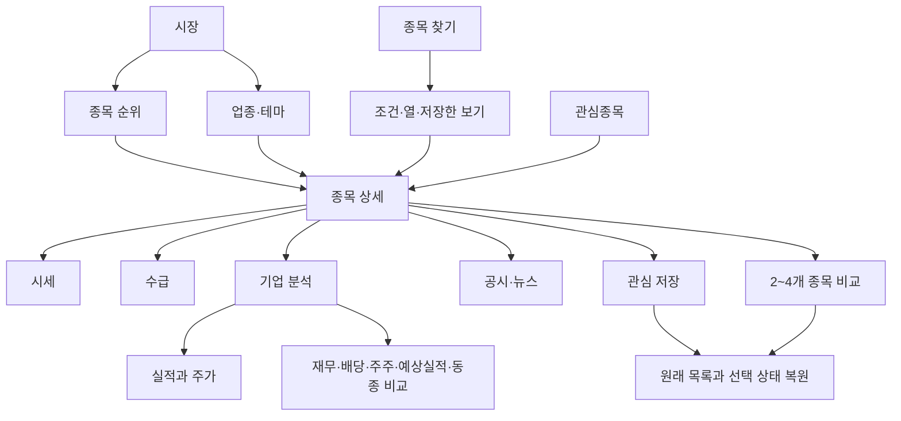
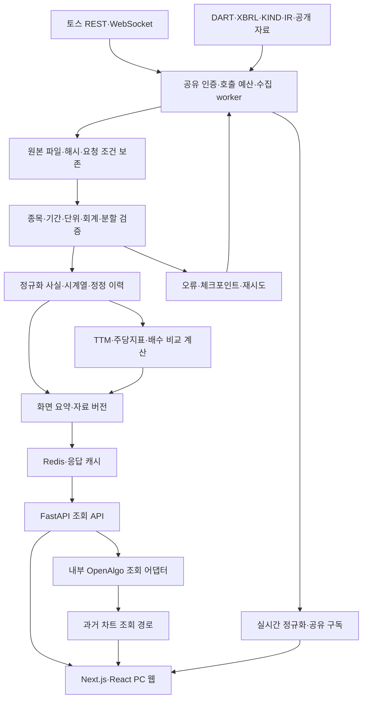

# 국내증시 — 서비스 소개·기획·설계·개발 현황

작성일: 2026년 10월 5일 · 문서 기준: 사용자의 최신 범위 결정, 현재 코드, 공개 배포 기록, 운영 자료 감사

공개 서비스: [국내증시](https://stocks.62-171-141-206.sslip.io/stocks)

> 국내증시는 국내 주식의 가격·수급·기업 실적을 한곳에서 찾아보고 비교하는 공개 웹서비스입니다. 로그인 없이 종목을 검색하고, 시세와 거래 자료를 확인하고, 기업 실적과 주가의 관계를 차트와 숫자 표로 읽을 수 있게 만듭니다. 핵심은 기능 개수가 아니라 원하는 정보를 찾고 이해한 뒤 원래 목록으로 돌아오는 과정입니다.

**현재 공개 서비스는 운영 중이지만 전체 완성 단계는 아닙니다.** 검색·순위·관심종목·비교·가격 차트·기업 분석의 기반은 구현돼 있습니다. 전 종목 과거 자료, 검증된 주당지표와 주식분할 기준, 배당 날짜, 실제 장중 수신과 장애 복구, 안정적인 공개 성능은 별도로 완료해야 합니다.

이 문서는 외부 소개와 내부 개발 기준을 함께 제공합니다. 소개할 때는 1~6장을, 구현과 현황을 검토할 때는 7~15장을 중심으로 읽으면 됩니다. 기능이 존재한다는 사실과 전 종목의 실제 자료가 검증됐다는 사실을 구분합니다.

## 목차

1. [목적과 해결하려는 문제](#1-목적과-해결하려는-문제)
2. [대상 사용자와 제품 범위](#2-대상-사용자와-제품-범위)
3. [제품의 중심 기능과 참고 서비스](#3-제품의-중심-기능과-참고-서비스)
4. [전체 화면 구조와 사용자 흐름](#4-전체-화면-구조와-사용자-흐름)
5. [기능 기획과 현재 제공 방식](#5-기능-기획과-현재-제공-방식)
6. [디자인과 문구 규칙](#6-디자인과-문구-규칙)
7. [실적과 주가의 계산 설계](#7-실적과-주가의-계산-설계)
8. [원천별 데이터 연결](#8-원천별-데이터-연결)
9. [기술 아키텍처와 저장 구조](#9-기술-아키텍처와-저장-구조)
10. [API와 실시간 처리](#10-api와-실시간-처리)
11. [운영·배포·성능](#11-운영배포성능)
12. [실제 개발 현황과 남은 차이](#12-실제-개발-현황과-남은-차이)
13. [기획과 개발의 진행 과정](#13-기획과-개발의-진행-과정)
14. [마무리 실행 계획과 완료 조건](#14-마무리-실행-계획과-완료-조건)
15. [문서 유지와 근거 자료](#15-문서-유지와-근거-자료)

## 1. 목적과 해결하려는 문제

국내 주식 자료는 이미 여러 서비스에 있습니다. 문제는 자료 자체의 부재만이 아닙니다. 시세·수급·재무·공시가 다른 화면에 흩어져 있고, 숫자의 기준과 단위를 확인하기 어렵고, 상세를 보고 돌아오면 읽던 목록을 다시 찾아야 하는 불편이 있습니다. 정보가 많은 화면에서는 무엇을 먼저 읽어야 하는지도 불분명합니다.

처음의 출발점은 1968년생 아버님이 편하게 사용할 수 있는 화면입니다. 그러나 서비스는 개인 전용 도구가 아니라 누구나 들어와 조회할 수 있는 공개 제품으로 만듭니다. 최신 결정에 따라 PC 웹을 우선하며, 기존 기본 반응형 동작은 유지합니다.

제품이 해결할 질문은 다음과 같습니다.

- 지금 시장에서 거래가 활발한 종목은 무엇인가요?
- 이 종목의 가격과 거래량은 어떤 흐름인가요?
- 개인·외국인·기관의 거래와 프로그램·공매도·신용·대차는 어떻게 달라졌나요?
- 기업의 이익과 현금흐름이 성장했나요? 주가는 그 실적과 어떤 관계로 움직였나요?
- 배당과 주요 주주, 예상실적, 공시의 실제 숫자는 무엇인가요?
- 관심 있는 종목을 저장하고 다음에 쉽게 다시 확인할 수 있나요?

목표는 데이터를 근거 없이 해석해 매수·매도를 권하는 것이 아닙니다. 실제 자료를 읽기 좋게 정리하고, 같은 기준으로 비교하고, 사용자가 가정을 바꿔 계산할 수 있게 하는 것입니다.

## 2. 대상 사용자와 제품 범위

### 2.1 사용자와 사용 상황

| 사용자 | 주요 상황 | 필요한 경험 |
|---|---|---|
| 익숙한 종목을 확인하는 사용자 | 검색 후 가격·수급·관심종목 확인 | 항상 보이는 검색, 명확한 종목명, 적은 조작 |
| 시장에서 종목을 찾는 사용자 | 거래대금·시가총액·등락·업종 탐색 | 읽기 쉬운 순위와 일관된 조건 변경 |
| 기업을 분석하는 사용자 | 과거 실적·가격·배당·재무 비교 | 큰 차트, 전체 기간, 정확한 표와 계산 기준 |
| 금융 용어에 익숙하지 않은 사용자 | 지표와 구분의 뜻 확인 | 짧은 설명, 큰 글씨, 설명을 닫은 뒤 위치 유지 |

### 2.2 확정 범위

| 포함 | 제외 |
|---|---|
| 코스피·코스닥 보통주·우선주 | 코넥스·ETF·ETN·상장형 수익증권·미국 종목 |
| 공개 조회, 종목 검색·조건 검색·비교 | 로그인·개인 계좌·주문·실제 매매 |
| 시세·가격 차트·거래 자료 | 주문 자동화·개인 보유자산 조회 |
| 재무·실적과 주가·배당·주주·공시 | 커뮤니티·자체 종합 투자점수 |
| 배당금·배당수익률·지급 이력 | 배당 재투자·현금배당 포함 총수익 비교 |
| 관심종목·그룹·보기·설정의 브라우저 저장 | 로그인 기반 기기 간 자동 동기화 |

증권사 연결은 **토스만** 사용합니다. 키움·한투의 인증·수집·실시간 실행 경로는 제거한 방향을 유지합니다. 다만 DART·KIND·기업 IR·검증된 공개 자료는 기업 분석을 위해 유지합니다. ‘토스 단일 연결’은 모든 기업 자료의 출처를 토스로 바꾼다는 뜻이 아닙니다.

새 유료 계약·서버 증설·호스팅 전면 이전을 기본 해결책으로 삼지 않습니다. 기존 자료와 사용자 설정은 보존하고, 범위 밖 자료가 저장돼 있어도 현재 서비스 분모와 수집 대상에서는 제외합니다.

## 3. 제품의 중심 기능과 참고 서비스

서비스의 중심은 **시장 탐색 → 종목 확인 → 실적과 주가 분석**입니다. 외형을 여러 서비스에서 가져와 섞기보다 하나의 화면 규칙으로 연결합니다.

| 참고 서비스 | 참고한 장점 | 국내증시에 적용하는 방식 |
|---|---|---|
| 토스인베스트 | 압축된 종목 요약, 큰 차트, 순위와 검색 중심 배치 | PC 화면의 정보 위계와 주요 탐색 구성 |
| 네이버증권 | 익숙한 순위, 시세·수급·재무의 숫자 표 | 차트 아래 정확한 값과 기간별 표 제공 |
| FnGuide | 회계 기준 선택, 재무·주주·예상실적·경쟁사 정보 | 기업 분석 안에서 요약과 상세를 단계적으로 연결 |
| FAST Graphs | 주가와 주당 실적을 같은 축에서 비교 | 여러 지표를 전환하는 ‘실적과 주가’ 차트 |
| Simply Wall St | 시장·업종·기업의 연결, 항목별 추세 | 성장·현금흐름·재무건전성·배당의 실제 숫자 시각화 |
| Seeking Alpha | 실적 변화, 예상실적, 배당과 동종 비교 | 숫자와 변화 중심의 기업 분석 묶음 |

이들의 모든 유료 화면이나 기능을 복제·전수 검증한 상태는 아닙니다. 위 표는 공개 화면과 문서에서 참고한 설계 원리이며, 국내증시의 실제 데이터 확보와 사용성을 대신 증명하지 않습니다.

차별점은 AI 사용 자체가 아닙니다. 한국어 화면에서 국내 거래 자료와 기업 분석을 연결하고, 중요한 차트와 표를 크게 읽으며, 설명·저장·복귀 과정이 끊기지 않도록 만드는 데 있습니다.

## 4. 전체 화면 구조와 사용자 흐름

### 4.1 정보 구조

상단 메뉴는 `시장 / 종목 찾기 / 관심종목 / 비교`입니다. 검색창은 아이콘 안에 숨기지 않고 입력창으로 제공합니다. 넓은 PC 화면에는 관심종목·최근 본 종목을 보조 영역으로 두고, 본문을 가리는 고정 제목은 사용하지 않습니다.

종목 상세의 상위 메뉴는 `시세 / 수급 / 기업 분석 / 공시·뉴스`입니다. 공매도·대차·신용은 수급 안에서, 재무·배당·주주 등은 기업 분석 안에서 엽니다. 기존 공유 링크는 새 위치로 연결하고 선택값을 유지하는 방향입니다.

### 4.2 핵심 왕복 흐름

| 단계 | 사용자 행동 | 시스템 동작과 확인 기준 |
|---|---|---|
| 시장 확인 | 지수와 순위 읽기 | 숫자·작은 차트·순위가 먼저 보임 |
| 검색 | 이름·코드·초성 입력 | 보통주·우선주를 구분한 결과, 키보드 선택 |
| 시세 확인 | 기간·선/캔들 변경 | 실제 OHLC, 선택한 거래일, 차트 아래 값 |
| 수급 확인 | 투자자·프로그램 등 선택 | 동일 기간의 그래프와 표, 수량·금액 구분 |
| 기업 분석 | 지표·기간·배수 변경 | 실적·주가·계산 기준이 함께 바뀜 |
| 설명 | 뜻 보기 열기·닫기 | 짧은 정의와 계산 조건, 원래 초점 복귀 |
| 저장·복귀 | 관심 추가 후 목록으로 돌아가기 | 취소 제공, 필터·정렬·스크롤 복원 |

차트 선택 복원 순서는 공유 링크 → 종목별 저장값 → 기본값입니다. 지표·배수를 바꿀 때 선택 날짜와 확대 범위를 유지합니다. 실시간 가격 갱신 때문에 읽는 행이 다른 위치로 이동하지 않습니다.

## 5. 기능 기획과 현재 제공 방식

아래는 기능 구성입니다. ‘구현’은 화면·API·로직이 있다는 뜻이며, 모든 종목·기간의 실제 자료 검증을 뜻하지 않습니다. 자료 확보 수준은 12장에서 별도로 다룹니다.

| 기능 | 현재 기반과 제공 방식 | 완성에 필요한 검증 |
|---|---|---|
| 시장·지수 | 지수 카드·차트, 시장 맥락 조회 | 시세와 차트 기준일, 금리 단위, 일정 연결 |
| 순위 | 거래대금·거래량·등락, 시가총액 등 | 토스 고객 순위와 시장 전체 구분, 지원 옵션 대조 |
| 종목 검색 | 검색 색인·이름·코드·초성 | 전 종목 식별, 우선주 구분, 공개 경유 속도 |
| 조건 검색 | 필터·정렬·열 선택·보기 저장·내보내기 | 결측 처리, AND/OR 의미, 같은 결과의 CSV |
| 관심종목 | 브라우저 저장·그룹·최근 본 종목 | 삭제 취소, 설정 보존, 복귀·백업 동작 |
| 비교 | 2~4개 종목의 차트·지표 | 회계 기준과 기간의 일치 |
| 가격 차트 | 선·영역·캔들·OHLC·거래량, 기간 선택 | 실제 봉, 오래된 장중 자료, 집계 경계 |
| 호가·체결 | REST 조회와 스트림 연결 기반 | 실제 장중 새 수신·화면 반영·단절 복구 |
| 수급 | 투자자·거래원·프로그램과 일별 표 | 전체 과거 자료, 거래시장·수량·금액 대조 |
| 공매도·대차·신용 | 각각의 조회·수집·화면 | 거래와 잔고 구분, 누락 페이지·404 보완 |
| 기업 분석 | 실적과 주가·재무·배당·주주·예상실적·동종 비교 | 실제 입력 확보, 분할 기준, 종목별 지원 범위 |
| 공시·뉴스·IR | 제목·날짜·기업 연결·원문 링크 | 정정 문서, 잘못된 기업 매핑·깨진 링크 |
| 설정·PWA | 테마·큰 글씨·설정 저장, 설치형 웹앱 기반 | 실제 설치·업데이트·오프라인·복귀 검증 |

가격 차트는 하루 선 차트를 기본으로 하며, 하루 캔들은 실제 분봉을 사용합니다. 고가·저가가 없다고 종가로 캔들을 만들어 채우지 않습니다. 주·월봉은 전체 집계 기간을 먼저 구성하고 화면 표시 구간을 자릅니다.

재무의 초기 표시가 3년이어도 저장과 탐색 범위를 3년으로 제한하지 않습니다. 전체 기간·전체 계정, 연간·분기·TTM, 연결·별도를 조회하는 구조를 사용합니다. 금액만 보여주지 않고 증감과 이익률을 함께 읽도록 보완합니다.

## 6. 디자인과 문구 규칙

### 6.1 화면 위계

가격·차트·목록이 중심입니다. 모든 내용을 같은 카드와 큰 제목으로 강조하지 않습니다. 보조 정보는 표·구분선·펼침 영역으로 배치하고, 같은 설명을 제목 아래와 빈 화면에서 반복하지 않습니다.

| 항목 | 설계 기준 |
|---|---|
| 배경 | 기본 흰색, 기존 다크·시스템 선택 유지 |
| 장식 | 그라데이션 제거, 의미 없는 카드·아이콘·텍스트 제거 |
| 글자 | 본문 16px·보조 14px·대표 가격 32px를 PC 기본값으로 사용 |
| 큰 글씨 | 기존 보통·크게·더 크게 유지, 확대 시 잘림 방지 |
| 숫자 | 오른쪽 정렬·고정폭 숫자·통일된 단위 |
| 표 | 기본 행 높이 48px, 비교 선택은 필요할 때 표시 |
| 버튼 | hover에서 색·테두리 등만 변화, 위치 이동 없음 |
| 설명 | 지표명과 뜻 보기, 클릭·키보드로 접근 |
| PC 배치 | 최대 폭 1680px, 넓은 화면의 보조 영역은 접기 가능 |
| 검증 크기 | 1024·1280·1440·1920px, 큰 글씨·200% 확대 |

위 값은 설계·검증 기준입니다. 모든 화면의 실제 측정이 완료됐다는 표시가 아닙니다. 토스의 전용 글꼴·로고·캐릭터를 가져오는 대신 자체 자산과 Pretendard·시스템 글꼴을 사용합니다. 마스코트는 도움말·소개·빈 상태에 제한하고 차트 위에 겹치지 않습니다.

### 6.2 문구와 상태

문구를 남기는 기준은 ‘사용자의 이해나 행동에 도움이 되는가’입니다. 지표명·단위·기간·장애 상태는 필요하지만, 화면 사용을 장황하게 설명하는 장식 문장은 삭제합니다.

| 상황 | 표시 원칙 |
|---|---|
| 정상 | 필요한 이름·숫자·기간만 표시 |
| 실제 조회 중 | 해당 영역의 로딩, 다른 영역은 계속 사용 |
| 조회 실패 | ‘불러오지 못했어요’와 다시 시도 |
| 원천 미제공 | 실제 근거가 확인된 경우에만 미제공 표시 |
| 오래된 정상 자료 | 자료 날짜와 필요한 장애 상태 표시 |
| 결측·계산 불가 | 0으로 바꾸지 않고 빈 값과 짧은 이유 |
| 오프라인 | 마지막 확인 자료를 현재 시세처럼 표현하지 않음 |

설명은 ‘뜻 한 문장 → 현재 값 읽는 법 → 계산 방식 펼치기’로 구성합니다. 운영 로그·오류 코드·인증정보는 사용자 화면에 노출하지 않습니다. 출처와 원본 추적은 내부 데이터 계약에 유지합니다.

## 7. 실적과 주가의 계산 설계

### 7.1 중심 차트

실제 주가와 `주당 지표 × 비교 배수`를 같은 원화 축에서 보여줍니다. 기본은 5년·기본 EPS·연결재무 우선이며, 검증된 TTM이 없으면 연간 자료임을 표시합니다. 한 선에 연간·TTM을 섞지 않습니다.

실적은 발표 이후부터 반영합니다. 발표 사이를 선형으로 채워 실제로 존재하지 않았던 중간 실적을 만들지 않습니다. 실제 주가, 선택 배수선, 선택적 과거 배수선을 색과 선 모양으로 구분합니다. 음수·결측 구간은 비교선을 끊되 실제 실적 숫자는 남깁니다.

### 7.2 지표 정의

| 지표 | 계산·사용 조건 |
|---|---|
| 기본 EPS | 보통주 귀속이익·가중평균 주식 수와 공시 EPS 대조 |
| 희석 EPS | 희석 분모와 귀속이익 조정·희석 조건 검증 |
| 조정 EPS | 기업이 공개한 조정 근거가 있는 자료만 사용 |
| OCF/주 | 영업활동 현금흐름을 동일 기간의 검증된 주식 수로 환산 |
| FCF/주 | 영업현금흐름 − 유형·무형자산 취득 현금지출 |
| FCFE/주 | 현금흐름 분류·설비투자·순차입 입력이 모두 검증된 경우 |
| EBITDA/주 | 정의와 조정 내역·감가상각 범위가 맞는 실제 입력 |
| EBIT/주 | 이자·세금 전 이익, 영업이익으로 자동 대체하지 않음 |
| 매출/주 | 동일 기간의 매출과 검증된 주식 수 |
| BPS | 해당 시점 보통주 귀속 순자산·주식 수, TTM 합산 제외 |
| FFO·AFFO | 기업의 공시 정의·조정 내역이 있는 경우만 사용 |

12개 지표의 정의·선택·계산 구조가 있지만, 모든 기업의 12개 지표에 실제 입력이 연결된 상태는 아닙니다. 특히 조정 EPS·FFO·AFFO는 OCF나 FCF의 다른 이름으로 처리하지 않습니다.

EPS 기본 비교 배수는 15배, BPS는 1배입니다. 다른 지표에 같은 15배를 일괄 적용하지 않습니다. 과거 대표 배수는 유효한 양수 월말 관측값 24개 이상에서 상·하위 각각 10%를 제외한 평균입니다. 표본이 부족하면 사용자 입력을 받거나 비교선을 만들지 않습니다.

이는 사후 비교 기준이며 당시의 적정 배수나 투자전략 성과가 아닙니다. `주당 EBITDA × 배수`도 EV/EBITDA를 이용한 기업가치 평가와 구분합니다.

### 7.3 TTM·주식분할·과거 시점

- 검증된 연속 네 분기의 금액을 먼저 합산합니다. 분기 EPS 네 개를 무조건 더하지 않습니다.
- 누적 차감은 같은 회계연도·연결 기준·계정 차원에서 수행합니다.
- 주식 수는 실제 기간 길이와 분할 단위를 반영합니다. 잔액은 최근 값, 비율은 다시 계산합니다.
- 원주가·수정주가·재작성 공시 숫자를 같은 분할 기준으로 맞춥니다. 이미 재작성된 숫자에 분할을 다시 적용하지 않습니다.
- 회사 재무총액과 개별 주식의 귀속 지표를 구분합니다. 보통주 EPS를 우선주에 자동 복사하지 않습니다.
- 공시 공개 시점과 정정 이력을 보존합니다. 날짜만 확인되면 다음 거래일부터 과거 분석에 적용하는 보수적 기준을 사용합니다.
- 금액은 Decimal, 계산 불가는 `null + 사유`로 다룹니다. 실제 0과 결측을 구분합니다.
- 서버가 비교 불가로 판정한 값을 브라우저에서 다시 곱해 비교선으로 복구하지 않습니다.

차트·표·CSV는 같은 계산 결과를 사용합니다. 전망 자료와 사용자 가정은 실제 과거 실적과 구분하며, 없는 예상실적을 생성하지 않습니다.

## 8. 원천별 데이터 연결

### 8.1 원천 역할

| 원천 | 담당 자료 | 확인할 차이 |
|---|---|---|
| 토스 REST·WebSocket | 가격·호가·체결·봉·투자자·프로그램·공매도 거래·신용·대차·순위·지표·일정 | 실제 옵션·단위·시장·제공 종목 범위 |
| OpenDART·XBRL | 회사 식별·공시·재무기간·계정·주주·배당 | 단독/누적·연결/별도·차원·정정·공개 시점 |
| KIND·기업 IR | 기업행사·배당 날짜·분할·기업 자료 | 실제 종목과 주식 종류·권리일·지급일 |
| 검증된 공개 수집기 | 기업 설명·테마·거래원·예상실적 등 보완 | 제공 범위·파서·최신성·기업 매핑 |

같은 현재가를 여러 증권사에 계속 중복 요청하지 않습니다. 토스가 없는 기업 자료를 갖고 있다고 가정하지 않으며, 기존 원천 자료의 출처를 토스로 바꾸지 않습니다. KRX API 키 발급은 현재 출시의 선행조건이 아닙니다.

### 8.2 토스 공개 시장 GET 20개

아래는 저장된 공식 REST 1.2.19·WebSocket 1.2.2 계약을 기준으로 연결한 범위입니다. 대표 실제 응답 기록은 있지만 모든 요청 옵션·모든 종목의 검증이 완료된 것은 아닙니다.

| 번호 | 기능 | 제품 사용처 |
|---|---|---|
| 1 | 현재가 | 종목 요약·목록 |
| 2 | 호가 | 잔량·호가 표 |
| 3 | 최근 체결 | 체결 목록 |
| 4 | 상하한가 | 종목 가격 제한 |
| 5 | 캔들 | 가격·거래량 차트·과거 자료 |
| 6 | 종목 기본정보 | 회사·종목 요약 |
| 7 | 시장별 전체 종목 | 식별·상장 목록 대조 |
| 8 | 유의사항·VI | 종목 상태 |
| 9 | 투자자 거래 | 개인·외국인·기관 수급 |
| 10 | 프로그램 거래 | 차익·비차익 거래 |
| 11 | 공매도 거래 | 거래량·거래대금 추세 |
| 12 | 신용 거래 | 융자·대주 자료 |
| 13 | 대차 | 거래·잔고 |
| 14 | 환율 | 시장 맥락 |
| 15 | 국내 장 일정 | 거래일·세션 |
| 16 | 미국 장 일정 | 일정 참고, 미국 종목 서비스는 제외 |
| 17 | 랭킹 | 제공되는 6종 순위·기간 |
| 18 | 시장 지표 현재가 | 지수·국채 금리 |
| 19 | 시장 지표 캔들 | 지수·금리 과거 추세 |
| 20 | 시장 투자자 매매대금 | 시장 전체 투자자 동향 |

인증과 국내 체결·호가 스트림은 이 20개 GET과 별도입니다. 개인 계좌·보유자산·주문 조회·주문 실행은 사용하지 않습니다.

### 8.3 혼동을 막는 계약

- 종목 투자자 거래의 주식 수와 시장 투자자의 매매대금을 구분합니다.
- 외국인 보유율과 당일 순매수는 다른 지표입니다.
- 프로그램 KRX 자료와 KRX+NXT 통합 자료를 같은 의미로 섞지 않습니다.
- 공매도 거래와 순보유잔고, 대차 거래와 잔고, 신용융자와 대주를 분리합니다.
- 토스 고객 거래 순위와 시장 전체 순위를 구분합니다.
- 지수는 포인트, 국채 2·3·5·10·20·30년은 금리 %로 표시합니다.
- 원천 거래일과 수집 시각을 분리합니다. 오래된 자료를 방금 수집했다고 현재 자료로 승격하지 않습니다.
- 404를 종목 식별 오류·목록 누락·자료 미지원·조건 문제·일시 장애로 나눕니다. 자료 하나의 실패로 종목 전체를 삭제하지 않습니다.

## 9. 기술 아키텍처와 저장 구조

### 9.1 구성과 역할

| 구성 | 역할 |
|---|---|
| Next.js·React·TypeScript | 화면·탐색·상태 복원·브라우저 설정 |
| Lightweight Charts | 가격·캔들·OHLC·거래량·실적 비교 차트 |
| FastAPI | 정규화 조회·조건 검색·분석·실시간 배포 |
| 별도 worker | 공급자 호출·공시·과거 자료·재시도·증분 갱신 |
| PostgreSQL | 배포 DB·장기 시계열·원천 사실·작업 상태 |
| SQLite | 로컬 실행과 검증 지원 |
| Redis | 조회 캐시·자료 버전·배포 지원 |
| 원본 파일 저장 | JSON·ZIP·XBRL·PDF의 원문과 해시 |
| Parquet·DuckDB | 보관·전체 검사에 사용하는 도구 기반 |
| OpenAlgo 내부 서비스 | 정규화된 quote·depth·history 조회 연동 |

Parquet·DuckDB 도구가 있다는 사실을 전체 자료가 이미 그 형식으로 검증·보관됐다는 뜻으로 사용하지 않습니다. OpenAlgo는 별도 토스 토큰을 발급하거나 주문 기능을 공개하지 않습니다. 내부 조회가 공개 차트 API를 다시 호출하는 순환 구조도 피합니다.

### 9.2 저장 단위

| 자료 | 주요 식별과 보존 항목 |
|---|---|
| 회사·종목 | 회사 ID·종목코드·주식 종류·상장 상태·식별 이력 |
| 원천 문서 | 공급자·요청 조건·파일 해시·공개/수집 시점·파서 버전 |
| 가격·거래 | 거래시장·간격·OHLCV·거래대금·조정 기준 |
| 재무 사실 | 계정·실제 기간·단위·통화·연결 기준·차원·공시 버전 |
| 주당 기준 | 주식 종류·주식 수·분할 단위·근거 문서·유효 기간 |
| 배당·행사 | 배당금·권리일·배당락일·지급일·분할·정정 |
| 예상실적 | 대상 기간·추정 기준일·제공된 집계 방식·기관 수 |
| 계산 결과 | 입력 사실·산식 버전·기준 시점·결과·불가 사유 |
| 수집 작업 | 종목×자료·과거/최신 커서·오류·재시도·재개 위치 |

긴 가격 이력은 정규화 시계열로 저장하고 JSON은 화면 요약으로 사용합니다. 새 가격 한 개 때문에 수십 년 가격 배열 전체를 다시 쓰는 구조를 줄였습니다. 불완전한 새 응답이 마지막 정상 자료를 지우지 않도록 합니다.

### 9.3 코드 위치

| 위치 | 내용 |
|---|---|
| `apps/web/app/stocks/page.tsx` | 주식 서비스 진입점 |
| `apps/web/app/components/market/` | 시장·검색·가격·실적·재무·비교 화면 |
| `services/market_dashboard/app.py` | 조회 API·스트림·상태 응답 |
| `services/market_dashboard/analysis_metrics.py` | 분석 지표 정의 |
| `services/market_dashboard/toss_backfill.py` | 과거 수집·작업 선택·커서 |
| `services/market_dashboard/store.py` | 스냅샷·시계열·DB 지원 |
| `ops/market/` | 컨테이너·배포 운영 설정 |
| `scripts/` | 배포·감사·검증 도구 |
| `tests/` | 계산·원천 계약·복구 회귀 검사 |
| `docs/releases/` | 릴리스별 변경·검증·미완료 기록 |

## 10. API와 실시간 처리

기존 공개 prefix `/api/market/v1`과 공유 링크를 유지합니다. 내부 원천 요청과 공개 조회를 분리하며, 비밀키는 수집 서버에서만 사용합니다.

| 대표 인터페이스 | 역할 |
|---|---|
| `/overview`, `/rankings`, `/market-context` | 시장·순위·일정·환율·지표 |
| `/listings`, `/search-index`, `/search` | 종목 목록·검색 |
| `/screener`, `/screener/export`, `/compare` | 조건 검색·내보내기·비교 |
| `/indices/{code}/chart`, `/indices/{code}/investors` | 지수 차트·시장 수급 |
| `/securities/{code}` | 요약·수급·기업 자료의 분리 조회 |
| `/securities/{code}/bars`, `/depth`, `/trading` | 봉·호가·체결 |
| `/securities/{code}/trading/history`, `/short-selling`, `/financing` | 과거 거래·공매도·대차·신용 |
| `/analysis/metrics`, `/securities/{code}/analysis/metrics` | 지표 정의·종목별 지원 상태 |
| `/securities/{code}/analysis/valuation` | 실적과 주가·배수 비교 |
| `/securities/{code}/financials/ttm`, `/financials/timeline`, `/financials/per-share` | 재무기간·TTM·주당지표 |
| `/securities/{code}/events`, `/warnings`, `/news`, `/peers` | 기업행사·상태·뉴스·동종 기업 |
| `/analysis/scenario` | 사용자 가정 계산 |
| `/stream` | WebSocket 공유 갱신 |

표의 종목별 축약 경로는 모두 `/securities/{code}` 아래를 뜻합니다. 구현 세부 인자와 현재 응답은 코드·계약 문서가 기준입니다. 제거한 `/analysis/performance`는 현재 기능에 포함하지 않습니다.

실시간 구독은 한 작업자가 소유하고 사용자가 같은 종목을 볼 때 공급자 구독을 중복 생성하지 않습니다. 현재가 요청은 최대 200종목 묶음, 스트림은 계정 한도 안에서 상세와 보이는 종목을 우선합니다. 현재 구현의 단일 연결·체결/호가 구독 수와 공급자 계약상 최대 연결 수를 혼동하지 않습니다.

처음 조회와 재연결은 REST 스냅샷, 이후는 실제 수신 이벤트를 반영합니다. 화면이 숨겨지면 요청을 줄이고 복귀 때 재동기화합니다. 토스 체결에 없는 매수·매도 방향·누적 거래량·유실 감지 순서 번호를 추정해 체결강도나 완전한 이력으로 표시하지 않습니다.

실시간 완료는 구독 승인이 아니라 **장중 새 이벤트 → 저장/정규화 → 실제 화면 → 단절 후 복구**를 확인한 상태입니다.

## 11. 운영·배포·성능

### 11.1 현재 운영 방식

VPS는 수집·DB·계산·실시간을 담당하고, 공개 Nginx 경로가 웹과 FastAPI로 연결됩니다. Cloudflare Worker는 성능 비교용 경로를 검증했지만 기본 공개 주소를 전면 이전하지 않았습니다.

운영 디렉터리는 `/srv/services/korea-stocks` 아래 `releases / shared / backups / current`로 분리합니다. 비밀값과 데이터는 코드 릴리스와 분리하고, 다른 VPS 서비스·공용 DB를 보존합니다. DB·Redis·OpenAlgo는 외부에 직접 공개하지 않습니다.

컨테이너 설정상 앱 메모리 한도는 API 1280MiB·worker 1536MiB·web 256MiB·OpenAlgo 256MiB로 합계 약 3.25GiB입니다. 이는 설정 한도이며 실제 피크 사용량이나 DB·Redis·호스트 전체 메모리를 뜻하지 않습니다. 로그 회전과 수집 동시 작업 제한을 적용합니다.

### 11.2 백업·복구

정기 백업과 배포 전 백업의 보존을 분리하고, 진행 중 파일을 정리 대상에서 제외하는 방향으로 개선했습니다. 일별 7개·주별 4개 보존과 별도 DB 복원 검사를 운영 기준으로 삼습니다.

백업 파일 존재와 복원 성공은 다른 검증입니다. 동일 VPS 백업과 외부 암호화 사본도 구분합니다. 현재 전체 운영 완료를 선언하려면 복원·프로세스 재시작·수집 재개·이전 앱 버전 복귀를 같은 운영 버전에서 확인해야 합니다. 앱 롤백 때문에 과거 DB를 자동 복원하거나 키움·한투가 재활성화되게 하지 않습니다.

### 11.3 속도 개선과 측정

첫 응답은 가격·차트·요약을 우선하고, 전체 재무·공시는 해당 영역에서 조회합니다. 동일 요청 병합, 응답 재사용, 자료 버전별 캐시, 작은 요약 응답을 사용합니다. 실시간 시세 변화 때문에 기업·재무 전체를 재생성하지 않습니다.

v80에서는 대표 상세 요약 응답을 이전 약 44,988bytes에서 1,887bytes로 줄였습니다. 약 95.8%의 응답 크기 감소이며 서비스 전체 속도가 같은 비율로 빨라졌다는 뜻은 아닙니다.

2026년 10월 5일 04:49 KST 기록의 공개 인터넷 100동시 HTTPS 측정은 다음과 같습니다. Windows PC에서 HTTP/1.1 연결을 사용한 특정 표본이며 현재 v88의 새 부하 시험은 아닙니다.

| 경로·요청 | 첫 100개 p95 | 연결 재사용 300개 p95 | 1.6초 뒤 100개 p95 | 목표 |
|---|---:|---:|---:|---:|
| VPS 검색 | 3468.08ms | 947.22ms | 1316.26ms | 300ms |
| VPS 상세 요약 | 581.96ms | 298.43ms | 599.99ms | 500ms |
| Cloudflare 검색 | 1381.08ms | 678.26ms | 860.92ms | 300ms |
| Cloudflare 상세 요약 | 1283.82ms | 634.45ms | 917.05ms | 500ms |

일부 조건에서 VPS 요약은 목표 안에 들었지만 전체 조건의 안정적 통과는 아닙니다. Cloudflare도 모든 요청에서 빠르지 않았습니다. 따라서 호스팅을 바꾸면 해결된다고 단정하지 않고 네트워크·TLS·연결 재사용·프록시·캐시·DB 확인 시간을 분리해야 합니다.

LCP 2.5초·INP 200ms·CLS 0.1과 전체 서비스 10배 개선은 목표이며 완료 실적이 아닙니다. 무료 인프라에도 호출·요청·CPU·저장 한도가 있으므로 무제한 무료 운영을 약속하지 않습니다.

## 12. 실제 개발 현황과 남은 차이

### 12.1 현황을 읽는 기준

전체 개발률을 임의의 한 숫자로 표시하지 않습니다. 화면 구현, 원천 자료 확보, 계산 검증, 공개 반영이 서로 다른 상태이기 때문입니다. 종목의 가격이 수집됐다고 그 종목의 재무·분할·배당까지 완료된 것도 아닙니다.

운영 자료는 계속 바뀝니다. 최신 읽기 전용 재조회는 이번 문서의 운영 감사 (로컬 보존 자료: `project-status-audit-20261005.json`), 아래 상세 분모는 명시한 저장 감사 시점을 기준으로 확인합니다.

### 12.2 과거 자료 — 2026년 10월 5일 20:29 KST 운영 재조회

유효 범위는 2,766종목, 자료 7종으로 19,362개 종목×자료 작업입니다.

| 자료 | 자료가 있는 종료 작업 | 원천 빈 자료 종료 | 수집 중 | 토스 목록 누락 |
|---|---:|---:|---:|---:|
| 수정 일봉 | 579 | 0 | 2186 | 1 |
| 투자자 수급 | 322 | 0 | 2443 | 1 |
| 프로그램 | 406 | 119 | 2240 | 1 |
| 공매도 거래 | 726 | 83 | 1956 | 1 |
| 신용 | 722 | 62 | 1981 | 1 |
| 대차 | 437 | 63 | 2265 | 1 |
| 원주가 일봉 | 579 | 0 | 2186 | 1 |

표는 작업 메타데이터 상태입니다. 종료는 원천 마지막 페이지 또는 빈 응답 등을 처리했다는 뜻이며 저장된 전체 기간의 무결성과 숫자 대조를 모두 통과했다는 뜻이 아닙니다. 일봉 확보율로 분봉 확보율을 대신하지 않습니다. 모든 자료가 끝난 종목 수는 이 표를 합산해서 구할 수 없습니다.

이번 재조회에서 범위 내 작업의 `error` 상태는 집계되지 않았습니다. 다만 백필 진행 레코드는 `capacity_limited`로 표시됐고, 마지막 시도는 54,749회였습니다. 공개 health의 일반 worker는 `collecting`이므로, health 정상과 과거 수집의 정상 진행을 같은 의미로 보지 않습니다. 이 문서 작성에서는 용량 제한의 구체적 원인을 추가 진단하지 않았으며, 수집이 무제한 계속되고 있다고 표현하지 않습니다. 제한 조건과 디스크·작업 정책을 확인한 뒤 재개 여부를 검증해야 합니다.

동일 재조회의 현재 토스 계측 세션에서는 공개 시장 GET 20개 경로 모두 성공 응답 누계가 있었습니다. 429는 기록되지 않았고 일부 경로에는 네트워크 오류 누계가 있었습니다. 이는 계측 세션의 응답 이력이며 모든 옵션·모든 종목·모든 기간을 통과했다는 증거는 아닙니다. 자세한 값은 운영 감사 JSON에 보존했습니다.

v86에서는 `001940` 공매도 작업이 ConnectTimeout에서 1,732행·마지막 커서 수신으로 복구됐고 당시 범위 내 오류 작업은 0건이었습니다. 토스 목록 누락 종목은 국내 목록에서 삭제하지 않고 근거와 재확인 조건을 관리합니다.

### 12.3 TTM·분할·배당·실시간

| 영역 | 확인된 결과 | 남은 작업 |
|---|---|---|
| 주당·분할 기준 | v84 감사에서 2766개 중 대표 3개 기준 검토 | 나머지 2763개와 전체 기간의 실제 근거 |
| 대표 분석 | 삼성전자·SK하이닉스·현대차 EPS/OCF/EBITDA 표본 | 전 종목 입력·지표별 가능 범위·정정·분할 |
| 최신 대표 TTM | 2026년 반기까지 실제 입력 연결 기록 | 전체 기간 연속성, 기업별 공시 EPS 대조 |
| 배당 저장 | v84 기준 838종목·1022행 | 배당락일 1019행, 지급일 534행 누락 보완 |
| 배당 검증 | 검증 플래그 6행 | 플래그와 실제 원문·정정·주식 종류 대조 확대 |
| 실시간 | 체결·호가 구독 승인과 연결 기반 | 실제 장중 새 이벤트·화면·단절 복구 증거 |
| 추가 지표 | 정의·계산·선택 구조 | FCFE·조정 EPS·FFO·AFFO 등 실제 입력 연결 |
| 공개 성능 | 요약 경량화, VPS/Cloudflare 비교 | 전체 조건 목표 통과·Core Web Vitals |
| 실사용 | 자동 화면·회귀 검증 기록 | 아버님의 실제 핵심 과제 수행과 수정 |

삼성전자 기준은 2016-01-01~2026-10-02, SK하이닉스는 2021-01-01~2026-10-02, 현대차는 2021-12-31~2026-10-02의 검토 기록입니다. 이는 세 종목의 모든 기능·모든 과거 자료가 완료됐다는 뜻이 아닙니다.

배당 행 수에는 이력·정정 검토가 필요합니다. 단순 저장 행 수를 현재 유효하고 완전한 배당 행사 수로 표현하지 않습니다. 기준일·배당락일·지급일은 서로 대체하지 않습니다.

### 12.4 최신 수집 개선

v81은 과거 시계열 메타데이터 계산 비용을 줄였고, v84~v86은 범위 밖 작업 보존과 오류 재시도 우선순위를 개선했습니다. v87~v88은 DART 공시 색인의 다음 페이지를 이어 수집하고 활성 조회가 없어도 전체 종목 순환을 유지하도록 보완했습니다.

최근 API·worker 배포 식별자는 `20261005-dart-index-continuation-v88`입니다. 이번 20:29 KST 공개 health 재조회에서 해당 식별자·PostgreSQL·2,766종목·`ok`를 확인했습니다. 웹 기능 버전 v76과 OpenAlgo 기능 버전 v73은 기존 배포 기록을 기준으로 별도 관리합니다. 컨테이너 이미지 태그만 같다고 모든 구성의 기능 코드가 동시에 바뀌었다고 판단하지 않습니다.

## 13. 기획과 개발의 진행 과정

| 단계 | 결정과 작업 | 얻은 교훈 |
|---|---|---|
| 초기 탐색 | MTS 자료를 쉽게 보는 공개 대시보드, 국내 종목·수급·재무 범위 설정 | 데이터와 화면을 한 흐름으로 설계해야 함 |
| 초기 구현 | 검색·순위·관심·비교·상세·설명·반응형 기반 | 메뉴 존재만으로 사용성과 연동 완료를 말할 수 없음 |
| 기업 분석 확장 | FAST Graphs·Simply Wall St 참고, 실적·가격 비교 | 지표 정의와 실제 입력을 분리하지 않으면 잘못된 선 생성 |
| 화면 방향 변경 | 모바일 우선에서 최신 PC 웹 우선·토스형 배치로 변경 | 최신 사용자 결정을 과거 설계보다 우선해야 함 |
| 원천 단일화 | 토스만 증권사로 사용, 키움·한투 실행 제거 | 인증·구독·보완 분기를 단순화하되 기업 원천은 유지 |
| 계산 정합성 | 기간 검증·TTM·분할·주당 기준·음수 처리 | 원본 숫자가 있어도 비교 가능한 숫자인지 따로 검증 |
| 마무리 범위 축소 | 코넥스·수익증권·배당 재투자 제외 | 새 기능보다 핵심 흐름과 알려진 미완료를 먼저 끝냄 |
| 운영·속도 개선 | 요약 분리·시계열 저장·재시도·DART 페이지 재개·성능 비교 | 작은 응답과 테스트 통과가 전체 성능·자료 완성을 뜻하지 않음 |

과거 `personal-fastgraphs` 등의 지표 혼합, 불가능한 CAGR의 0 처리, 잘못된 공통 배수, 연간 가격을 이용한 배당 재투자 계산을 재사용하지 않는 기준을 세웠습니다. 최신 범위에서는 배당 재투자 기능 자체를 제거했습니다.

개발이 늦어진 원인은 화면·기능 범위가 여러 차례 확대·변경됐고, 실제 자료 수집과 지표의 기간·주식 단위 검증이 UI 구현보다 오래 걸리며, 원천 응답과 공개 인터넷 지연이 서로 다른 병목이기 때문입니다. 이를 이유로 미완료를 완료로 바꾸지 않고 기능 추가보다 남은 검증과 자료 연결을 우선합니다.

## 14. 마무리 실행 계획과 완료 조건

### 14.1 우선순위

| 순서 | 작업 | 결과물·통과 기준 |
|---|---|---|
| 1 | 전 종목 과거 수집과 404 분류 | 마지막 페이지·저장 기간·중복/누락 검사, 재시작 재개 |
| 2 | TTM·주당 기준·분할 확대 | 실제 입력부터 계산·차트·표까지 추적 가능한 기업별 검증 |
| 3 | 배당 원문·날짜·주식 종류 | 지급·권리·배당락 구분, 정정·우선주 대조 |
| 4 | 토스 20개 API 옵션·화면 대조 | 요청→원본→정규화→저장→화면의 기능 대조표 |
| 5 | 실제 장중 수신 | 새 체결·호가, 화면 반영, 강제 단절·복구 |
| 6 | 속도·UX·운영 최종 검증 | 공개 부하·확대·복귀·백업·재시작·아버님 과제 |

과거 수집은 서버에서 계속하고, 기다리는 동안 계산·화면·운영의 독립 작업을 진행합니다. 오류 재시도와 신규 수집의 균형을 유지하며, 단순 동시 호출 증가로 공급자 한도와 서비스 응답을 악화시키지 않습니다.

### 14.2 검증 과제

- **자료:** 보통주·우선주·신규 상장·거래정지·적자·비12월 결산·정정·분할·누적 현금흐름 사례.
- **계산:** 기간 누락·중복·단위·차원 혼합·주식 수 변화·공개 전 정보 사용·결측의 0 변환 방지.
- **차트:** 실제 OHLC, 지표 변경과 배수 변경 후 날짜·확대 유지, 표·CSV 값 일치.
- **장애:** 인증 만료·원천 지연·토큰 재발급·재시작·단절·부분 수집에도 마지막 정상 자료 보존.
- **UX:** 검색·키보드 선택·기간 변경·수급·실적 차트·뜻 보기·관심 저장·목록 복귀.
- **성능:** 공개 인터넷 100동시 검색 p95 300ms·요약 500ms, 캐시 적중/미적중/만료와 네트워크 시간 구분.
- **운영:** 백업 복원·앱 롤백·수집 재개·로그/디스크 제한·구성별 실행 버전 확인.
- **실사용:** 아버님이 도움 없이 핵심 흐름을 수행하고 다음 날 다시 사용할 수 있는지 확인.

### 14.3 최종 완료 정의

기능별로 `구현 / 실제 자료 / 화면 검증 / 공개 반영`을 따로 기록합니다. 전체 완료는 다음 조건을 함께 충족한 상태입니다.

1. 확정 범위의 핵심 화면과 기능이 같은 공개 버전에서 작동합니다.
2. 제공 가능한 자료의 미수집과 알려진 오류를 해결하고, 근거 있는 미제공은 별도로 남깁니다.
3. 주당지표·TTM·분할·배당의 의미와 날짜가 원문·표·차트에서 일치합니다.
4. 실제 장중 수신과 장애 후 복구를 확인합니다.
5. 공개 성능과 사용자 왕복 과제를 검증합니다.
6. 기존 사용자 자료와 다른 VPS 서비스를 보존하고 복원 경로를 확인합니다.

외부 자료에 없는 조정 지표를 만들어 채우지는 않습니다. 반대로 실제 자료가 있는데 수집·매핑·계산하지 못한 상태는 미제공으로 돌리지 않습니다. 현재는 이 완료 조건을 전부 통과하지 않았습니다.

## 15. 문서 유지와 근거 자료

이 기획서는 최신 제품 범위를 고정하고 현재 차이를 설명하는 문서입니다. 실행의 세부 기준은 [마무리 실행 계획](FINISHING_PLAN.md), API 필드 기준은 [토스 계약](toss-api-contract.md), 실제 검증은 릴리스 기록과 운영 감사가 담당합니다. 과거 문서의 LUXON·코넥스·모바일 우선·키움/한투·배당 재투자 범위는 최신 결정으로 대체합니다.

### 내부 근거

- [서비스 README](../README-MARKET.md)
- [마무리 실행 계획](FINISHING_PLAN.md)
- [토스 API 계약](toss-api-contract.md)
- 문서 작성 시 운영 감사 (로컬 보존 자료: `project-status-audit-20261005.json`)
- v87 과거 자료 작업 상태 (로컬 보존 자료: `backfill-status-v87-20261005.json`)
- v84 주당·분할 기준 감사 (로컬 보존 자료: `share-basis-coverage-v84-20261005.json`)
- v84 배당 자료 감사 (로컬 보존 자료: `dividend-coverage-v84-20261005.json`)
- [v80 공개 성능·요약 개선 기록](releases/20261005-v80/ACCEPTANCE.md)
- [v86 오류 재시도·운영 기록](releases/20261005-v86/ACCEPTANCE.md)

### 외부 참고

아래 링크는 서비스와 공식 문서를 다시 확인하기 위한 참고입니다. 현재 기획의 근거와 최신 명세는 저장 계약·실제 응답을 함께 대조해야 합니다.

- [토스인베스트](https://www.tossinvest.com/)
- [토스 REST 명세](https://openapi.tossinvest.com/openapi-docs/latest/openapi.json)
- [토스 WebSocket 명세](https://openapi.tossinvest.com/openapi-docs/latest/asyncapi.json)
- [네이버증권 삼성전자](https://stock.naver.com/domestic/stock/005930/price)
- [FnGuide 삼성전자](https://wcomp.fnguide.com/CompanyInfo/Snapshot?cmp_cd=005930)
- [FAST Graphs 지표 설명](https://docs.fastgraphs.com/en/articles/9457734-metrics)
- [Simply Wall St 한국 시장](https://simplywall.st/markets/kr)
- [Seeking Alpha 종목 화면 안내](https://seekingalpha.com/article/4664209-webinar-replay-navigating-seeking-alpha-symbol-pages)
- [OpenDART 재무 명세](https://opendart.fss.or.kr/guide/detail.do?apiGrpCd=DS003&apiId=2019020)
- [Lightweight Charts](https://tradingview.github.io/lightweight-charts/docs/series-types)
- [OpenAlgo](https://github.com/marketcalls/openalgo)

문서를 갱신할 때는 작성일·조회 시각·실행 버전·분모를 함께 바꾸고, 구현된 기능과 실제 자료·검증의 차이를 유지합니다. 배포 횟수·코드 양·자동 수집 실행을 제품 완성의 대체 지표로 사용하지 않습니다.
